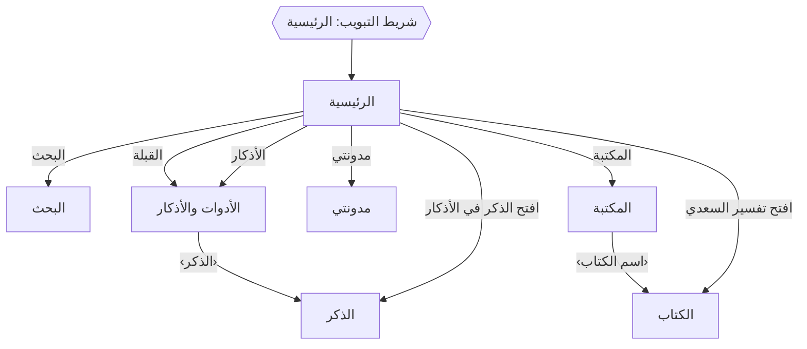
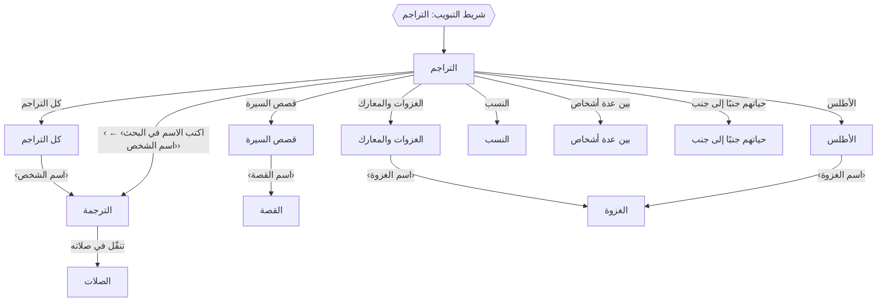
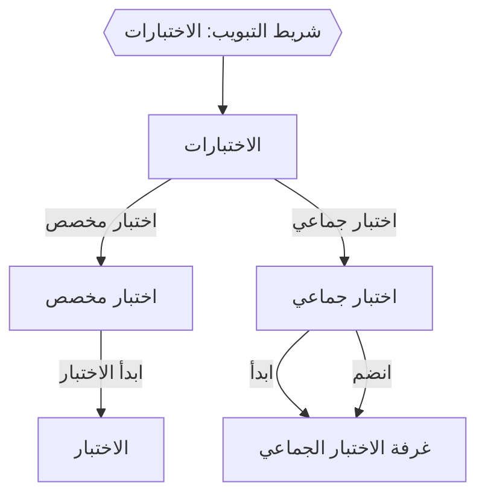

# The app's feature map

Every screen of the phone app, by the name a person would give it, and the tap that opens it. Use these names when
talking about the app and with `npm run phone -- open <name>`. This file is written by `npm run feature-map` from
[e2e/featureMap.mjs](../e2e/featureMap.mjs); `e2e/featureMap.test.ts` fails when a route file in `mobile/src/app` is
missing from the map, when a fixed label in the map no longer appears in the app's code, when a screen cannot be
reached from the tab bar, or when this file is out of date.

On the arrows, `←` separates taps made one after another, and a label in ‹› is not fixed text: what a row shows (a
name, a title), something typed into the search, or a gesture. A rounded, dashed box is a screen from another section
that leads in.

A section groups screens by topic under the tab bar button that leads to them. Screens outside `mobile/src/app/(tabs)`
open over the whole screen and cover the tab bar; the table marks them `covered`.

## القرآن

## الحديث

## الرئيسية

## التراجم

## الاختبارات

## خارج الشريط

## Every screen

| Screen | Opens with | Tab bar | Reached from | File |
| --- | --- | --- | --- | --- |
| القرآن | `/quran` | shown | شريط التبويب: القرآن | `mobile/src/app/(tabs)/(quran)/quran.tsx` |
| المصحف | `/read` | shown | القرآن ← المصحف | `mobile/src/app/(tabs)/read.tsx` |
| صفحة الآية | `/ayah?key=1:1` | covered | المصحف ← ‹اضغط مطولًا على آية› ← صفحة الآية الرئيسية ← افتح صفحة الآية | `mobile/src/app/ayah.tsx` |
| متشابهات القرآن | `/branches` | shown | القرآن ← متشابهات القرآن صفحة الآية ← متشابهات الآية ← افتح في المتشابهات | `mobile/src/app/(tabs)/(quran)/branches.tsx` |
| مقارنة السور | `/compare` | shown | القرآن ← مقارنة السور الرئيسية ← افتح الآيات المتشابهة | `mobile/src/app/(tabs)/(quran)/compare.tsx` |
| قصص الأنبياء | `/prophets` | shown | القرآن ← قصص الأنبياء | `mobile/src/app/(tabs)/(quran)/prophets.tsx` |
| قصة النبي | `/prophets/musa` | covered | البحث ← ‹اكتب اسم النبي› ← ‹اسم النبي› الرئيسية ← ‹بطاقة قصة نبي› | `mobile/src/app/prophets/[slug].tsx` |
| تحفة الأطفال | `/tuhfa` | shown | القرآن ← تحفة الأطفال | `mobile/src/app/(tabs)/(quran)/tuhfa.tsx` |
| ألفاظ القرآن | `/words` | shown | القرآن ← ألفاظ القرآن | `mobile/src/app/(tabs)/(quran)/words.tsx` |
| الكلمة | `/word?ids=814` | shown | ألفاظ القرآن ← ‹الكلمة› | `mobile/src/app/(tabs)/(quran)/word.tsx` |
| الأقسام | `/oaths` | shown | القرآن ← الأقسام | `mobile/src/app/(tabs)/(quran)/oaths.tsx` |
| مشاهد | `/lataif` | shown | القرآن ← مشاهد الرئيسية ← مشاهد | `mobile/src/app/(tabs)/(quran)/lataif.tsx` |
| المشهد | `/scene?id=rahman` | covered | مشاهد ← ‹غلاف المشهد› | `mobile/src/app/scene.tsx` |
| مصطلحات البلاغة | `/terms` | shown | القرآن ← مصطلحات البلاغة | `mobile/src/app/(tabs)/(quran)/terms.tsx` |
| المصطلح | `/term?name=الجناس` | shown | مصطلحات البلاغة ← ‹اسم المصطلح› | `mobile/src/app/(tabs)/(quran)/term.tsx` |
| القراءات | `/qiraat` | shown | القرآن ← القراءات | `mobile/src/app/(tabs)/(quran)/qiraat.tsx` |
| فواتح السور | `/openings` | shown | القرآن ← فواتح السور | `mobile/src/app/(tabs)/(quran)/openings.tsx` |
| ترتيب السور | `/order` | shown | القرآن ← ترتيب السور | `mobile/src/app/(tabs)/(quran)/order.tsx` |
| الحديث | `/hadith` | shown | شريط التبويب: الحديث | `mobile/src/app/(tabs)/(hadith)/hadith.tsx` |
| كتاب الحديث | `/hadith-book?book=bukhari` | shown | الحديث ← ‹اسم الكتاب› | `mobile/src/app/(tabs)/(hadith)/hadith-book.tsx` |
| أبواب الكتاب | `/hadith-kitab?book=bukhari&kitab=2` | shown | الحديث ← ‹كتاب من الصحيح› كتاب الحديث ← ‹كتاب من الصحيح› | `mobile/src/app/(tabs)/(hadith)/hadith-kitab.tsx` |
| حديث الصحيح | `/hadith-sahih?book=bukhari&n=1` | shown | أبواب الكتاب ← ‹الحديث› البحث ← ‹اكتب من نص الحديث› ← ‹الحديث› | `mobile/src/app/(tabs)/(hadith)/hadith-sahih.tsx` |
| حديث الأربعين | `/hadith-forty?n=1` | shown | الحديث ← ‹رقم الحديث› | `mobile/src/app/(tabs)/(hadith)/hadith-forty.tsx` |
| رواية الصحيح | `/hadith-unit?unit=muslim-jibril` | shown | حديث الأربعين ← المشاهد في صحيح مسلم | `mobile/src/app/(tabs)/(hadith)/hadith-unit.tsx` |
| الرئيسية | `/` | shown | شريط التبويب: الرئيسية | `mobile/src/app/(tabs)/(home)/index.tsx` |
| البحث | `/search` | shown | الرئيسية ← البحث | `mobile/src/app/(tabs)/(home)/search.tsx` |
| الأدوات والأذكار | `/utilities` | shown | الرئيسية ← القبلة الرئيسية ← الأذكار | `mobile/src/app/(tabs)/(home)/utilities.tsx` |
| الذكر | `/dhikr?occasion=waking&id=waking-life` | shown | الأدوات والأذكار ← ‹الذكر› الرئيسية ← افتح الذكر في الأذكار | `mobile/src/app/(tabs)/(home)/dhikr.tsx` |
| مدونتي | `/library` | shown | الرئيسية ← مدونتي | `mobile/src/app/(tabs)/(home)/library.tsx` |
| المكتبة | `/books` | shown | الرئيسية ← المكتبة | `mobile/src/app/(tabs)/(library)/books.tsx` |
| الكتاب | `/book?id=sadi` | shown | المكتبة ← ‹اسم الكتاب› الرئيسية ← افتح تفسير السعدي | `mobile/src/app/(tabs)/(library)/book.tsx` |
| التراجم | `/tarajim` | shown | شريط التبويب: التراجم | `mobile/src/app/(tabs)/(tarajim)/tarajim.tsx` |
| كل التراجم | `/people` | shown | التراجم ← كل التراجم | `mobile/src/app/(tabs)/(tarajim)/people.tsx` |
| الترجمة | `/person?slug=abu-bakr-as-siddiq` | shown | كل التراجم ← ‹اسم الشخص› التراجم ← ‹اكتب الاسم في البحث› ← ‹اسم الشخص› | `mobile/src/app/(tabs)/(tarajim)/person.tsx` |
| الصلات | `/ties?slug=abu-bakr-as-siddiq` | shown | الترجمة ← تنقّل في صلاته | `mobile/src/app/(tabs)/(tarajim)/ties.tsx` |
| قصص السيرة | `/stories` | shown | التراجم ← قصص السيرة | `mobile/src/app/(tabs)/(tarajim)/stories.tsx` |
| القصة | `/story?slug=islam-of-dimad` | shown | قصص السيرة ← ‹اسم القصة› | `mobile/src/app/(tabs)/(tarajim)/story.tsx` |
| الغزوات والمعارك | `/battles` | shown | التراجم ← الغزوات والمعارك | `mobile/src/app/(tabs)/(tarajim)/battles.tsx` |
| الغزوة | `/battle?slug=badr` | shown | الغزوات والمعارك ← ‹اسم الغزوة› الأطلس ← ‹اسم الغزوة› | `mobile/src/app/(tabs)/(tarajim)/battle.tsx` |
| الأطلس | `/atlas` | shown | التراجم ← الأطلس | `mobile/src/app/(tabs)/(tarajim)/atlas.tsx` |
| النسب | `/nasab` | shown | التراجم ← النسب | `mobile/src/app/(tabs)/(tarajim)/nasab.tsx` |
| بين عدة أشخاص | `/between` | shown | التراجم ← بين عدة أشخاص | `mobile/src/app/(tabs)/(tarajim)/between.tsx` |
| حياتهم جنبًا إلى جنب | `/life` | shown | التراجم ← حياتهم جنبًا إلى جنب | `mobile/src/app/(tabs)/(tarajim)/life.tsx` |
| الاختبارات | `/quizzes` | shown | شريط التبويب: الاختبارات | `mobile/src/app/(tabs)/quizzes.tsx` |
| اختبار مخصص | `/quiz/solo` | covered | الاختبارات ← اختبار مخصص | `mobile/src/app/quiz/solo.tsx` |
| الاختبار | `/quiz/play` | covered | اختبار مخصص ← ابدأ الاختبار | `mobile/src/app/quiz/play.tsx` |
| اختبار جماعي | `/quiz/party` | covered | الاختبارات ← اختبار جماعي | `mobile/src/app/quiz/party/index.tsx` |
| غرفة الاختبار الجماعي | `/quiz/party/000000` | covered | اختبار جماعي ← ابدأ اختبار جماعي ← انضم | `mobile/src/app/quiz/party/[code].tsx` |
| عن نمق | `/about` | covered | الرئيسية ← الإعدادات ← عن نمق | `mobile/src/app/about.tsx` |
| سياسة الخصوصية | `/privacy` | covered | الرئيسية ← الإعدادات ← سياسة الخصوصية | `mobile/src/app/privacy.tsx` |
| المصادر والتراخيص | `/attributions` | covered | الرئيسية ← الإعدادات ← المصادر والتراخيص | `mobile/src/app/attributions.tsx` |
| مقاسات الأشجار | `/tree-sizes` | covered | لا يُفتح من التطبيق (npm run tree-sizes opens it to measure every tree) | `mobile/src/app/tree-sizes.tsx` |

## Adding a screen

Add the route file, then an entry in `SCREENS` in `e2e/featureMap.mjs`, and run `npm run feature-map`:

- `file`: the route file under `mobile/src/app`, without `.tsx`.
- `name`: what a person would call the screen. It must be unique.
- `section`: the tab bar button whose topic it belongs to, or «خارج الشريط».
- `tabBar`: only on the screen a tab bar button opens, the button's label.
- `from`: each way in, as the screen a person is on, then the labels tapped there in order. A label in ‹› is what a
  row shows, a typed search or a gesture; every other label must appear in the app's code.
- `sample`: for a screen that needs params, a query (`?slug=badr`) or a path (`/musa`) that gives it something to show. The party room's `/000000` is no real room, so it opens on the room's empty state.
- `unlinked`: why nothing in the app opens the screen, for a tool such as `tree-sizes`.
