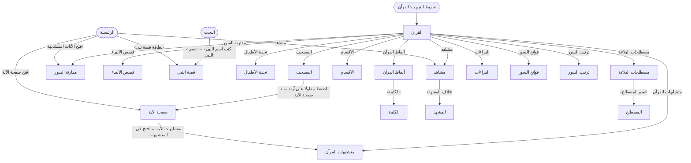
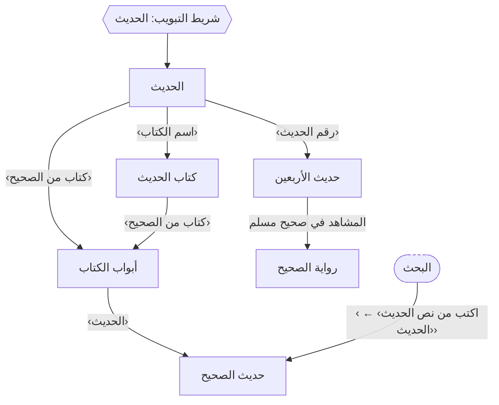
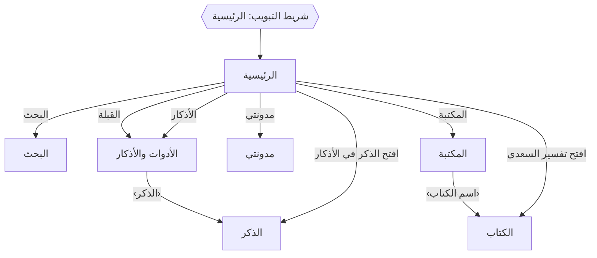
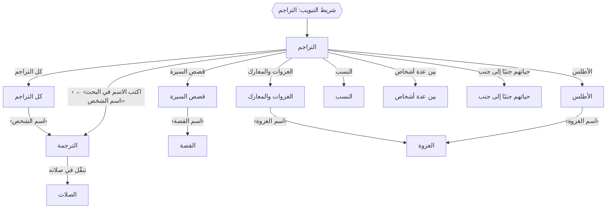
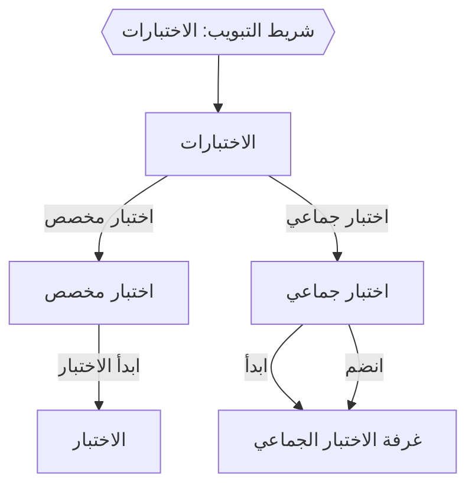
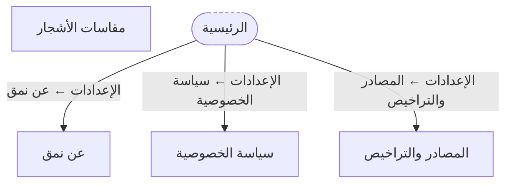

# The app's feature map

Every screen of the phone app, by the name a person would give it, and the tap that opens it. Each screen's name below
leads to its own page: the ways in, every button and card that opens another screen, and its sheets. Use these names when
talking about the app and with `npm run phone -- open <name>`. This file is written by `npm run feature-map` from
[e2e/featureMap.mjs](../e2e/featureMap.mjs); `e2e/featureMap.test.ts` fails when a route file in `mobile/src/app` is
missing from the map, when a fixed label in the map no longer appears in the app's code, when a screen cannot be
reached from the tab bar, or when this file is out of date.

On the arrows, `←` separates taps made one after another, and a label in ‹› is not fixed text: what a row shows (a
name, a title), something typed into the search, or a gesture. A rounded, dashed box is a screen from another section
that leads in.

A section groups screens by topic under the tab bar button that leads to them. Screens outside `mobile/src/app/(tabs)`
open over the whole screen and cover the tab bar; the table marks them `covered`.

## القرآن

## الحديث

## الرئيسية

## التراجم

## الاختبارات

## خارج الشريط

## Every screen

| Screen | Opens with | Tab bar | Reached from | File |
| --- | --- | --- | --- | --- |
| [القرآن](feature-map/quran.md) | `/quran` | shown | شريط التبويب: القرآن | `mobile/src/app/(tabs)/(quran)/quran.tsx` |
| [المصحف](feature-map/read.md) | `/read` | shown | القرآن ← المصحف | `mobile/src/app/(tabs)/read.tsx` |
| [صفحة الآية](feature-map/ayah.md) | `/ayah?key=1:1` | covered | المصحف ← ‹اضغط مطولًا على آية› ← صفحة الآية الرئيسية ← افتح صفحة الآية | `mobile/src/app/ayah.tsx` |
| [متشابهات القرآن](feature-map/branches.md) | `/branches` | shown | القرآن ← متشابهات القرآن صفحة الآية ← متشابهات الآية ← افتح في المتشابهات | `mobile/src/app/(tabs)/(quran)/branches.tsx` |
| [مقارنة السور](feature-map/compare.md) | `/compare` | shown | القرآن ← مقارنة السور الرئيسية ← افتح الآيات المتشابهة | `mobile/src/app/(tabs)/(quran)/compare.tsx` |
| [قصص الأنبياء](feature-map/prophets.md) | `/prophets` | shown | القرآن ← قصص الأنبياء | `mobile/src/app/(tabs)/(quran)/prophets.tsx` |
| [قصة النبي](feature-map/prophets-slug.md) | `/prophets/musa` | covered | البحث ← ‹اكتب اسم النبي› ← ‹اسم النبي› الرئيسية ← ‹بطاقة قصة نبي› | `mobile/src/app/prophets/[slug].tsx` |
| [تحفة الأطفال](feature-map/tuhfa.md) | `/tuhfa` | shown | القرآن ← تحفة الأطفال | `mobile/src/app/(tabs)/(quran)/tuhfa.tsx` |
| [ألفاظ القرآن](feature-map/words.md) | `/words` | shown | القرآن ← ألفاظ القرآن | `mobile/src/app/(tabs)/(quran)/words.tsx` |
| [الكلمة](feature-map/word.md) | `/word?ids=814` | shown | ألفاظ القرآن ← ‹الكلمة› | `mobile/src/app/(tabs)/(quran)/word.tsx` |
| [الأقسام](feature-map/oaths.md) | `/oaths` | shown | القرآن ← الأقسام | `mobile/src/app/(tabs)/(quran)/oaths.tsx` |
| [مشاهد](feature-map/lataif.md) | `/lataif` | shown | القرآن ← مشاهد الرئيسية ← مشاهد | `mobile/src/app/(tabs)/(quran)/lataif.tsx` |
| [المشهد](feature-map/scene.md) | `/scene?id=rahman` | covered | مشاهد ← ‹غلاف المشهد› | `mobile/src/app/scene.tsx` |
| [مصطلحات البلاغة](feature-map/terms.md) | `/terms` | shown | القرآن ← مصطلحات البلاغة | `mobile/src/app/(tabs)/(quran)/terms.tsx` |
| [المصطلح](feature-map/term.md) | `/term?name=الجناس` | shown | مصطلحات البلاغة ← ‹اسم المصطلح› | `mobile/src/app/(tabs)/(quran)/term.tsx` |
| [القراءات](feature-map/qiraat.md) | `/qiraat` | shown | القرآن ← القراءات | `mobile/src/app/(tabs)/(quran)/qiraat.tsx` |
| [فواتح السور](feature-map/openings.md) | `/openings` | shown | القرآن ← فواتح السور | `mobile/src/app/(tabs)/(quran)/openings.tsx` |
| [ترتيب السور](feature-map/order.md) | `/order` | shown | القرآن ← ترتيب السور | `mobile/src/app/(tabs)/(quran)/order.tsx` |
| [الحديث](feature-map/hadith.md) | `/hadith` | shown | شريط التبويب: الحديث | `mobile/src/app/(tabs)/(hadith)/hadith.tsx` |
| [كتاب الحديث](feature-map/hadith-book.md) | `/hadith-book?book=bukhari` | shown | الحديث ← ‹اسم الكتاب› | `mobile/src/app/(tabs)/(hadith)/hadith-book.tsx` |
| [أبواب الكتاب](feature-map/hadith-kitab.md) | `/hadith-kitab?book=bukhari&kitab=2` | shown | الحديث ← ‹كتاب من الصحيح› كتاب الحديث ← ‹كتاب من الصحيح› | `mobile/src/app/(tabs)/(hadith)/hadith-kitab.tsx` |
| [حديث الصحيح](feature-map/hadith-sahih.md) | `/hadith-sahih?book=bukhari&n=1` | shown | أبواب الكتاب ← ‹الحديث› البحث ← ‹اكتب من نص الحديث› ← ‹الحديث› | `mobile/src/app/(tabs)/(hadith)/hadith-sahih.tsx` |
| [حديث الأربعين](feature-map/hadith-forty.md) | `/hadith-forty?n=1` | shown | الحديث ← ‹رقم الحديث› | `mobile/src/app/(tabs)/(hadith)/hadith-forty.tsx` |
| [رواية الصحيح](feature-map/hadith-unit.md) | `/hadith-unit?unit=muslim-jibril` | shown | حديث الأربعين ← المشاهد في صحيح مسلم | `mobile/src/app/(tabs)/(hadith)/hadith-unit.tsx` |
| [الرئيسية](feature-map/home.md) | `/` | shown | شريط التبويب: الرئيسية | `mobile/src/app/(tabs)/(home)/index.tsx` |
| [البحث](feature-map/search.md) | `/search` | shown | الرئيسية ← البحث | `mobile/src/app/(tabs)/(home)/search.tsx` |
| [الأدوات والأذكار](feature-map/utilities.md) | `/utilities` | shown | الرئيسية ← القبلة الرئيسية ← الأذكار | `mobile/src/app/(tabs)/(home)/utilities.tsx` |
| [الذكر](feature-map/dhikr.md) | `/dhikr?occasion=waking&id=waking-life` | shown | الأدوات والأذكار ← ‹الذكر› الرئيسية ← افتح الذكر في الأذكار | `mobile/src/app/(tabs)/(home)/dhikr.tsx` |
| [مدونتي](feature-map/library.md) | `/library` | shown | الرئيسية ← مدونتي | `mobile/src/app/(tabs)/(home)/library.tsx` |
| [المكتبة](feature-map/books.md) | `/books` | shown | الرئيسية ← المكتبة | `mobile/src/app/(tabs)/(library)/books.tsx` |
| [الكتاب](feature-map/book.md) | `/book?id=sadi` | shown | المكتبة ← ‹اسم الكتاب› الرئيسية ← افتح تفسير السعدي | `mobile/src/app/(tabs)/(library)/book.tsx` |
| [التراجم](feature-map/tarajim.md) | `/tarajim` | shown | شريط التبويب: التراجم | `mobile/src/app/(tabs)/(tarajim)/tarajim.tsx` |
| [كل التراجم](feature-map/people.md) | `/people` | shown | التراجم ← كل التراجم | `mobile/src/app/(tabs)/(tarajim)/people.tsx` |
| [الترجمة](feature-map/person.md) | `/person?slug=abu-bakr-as-siddiq` | shown | كل التراجم ← ‹اسم الشخص› التراجم ← ‹اكتب الاسم في البحث› ← ‹اسم الشخص› | `mobile/src/app/(tabs)/(tarajim)/person.tsx` |
| [الصلات](feature-map/ties.md) | `/ties?slug=abu-bakr-as-siddiq` | shown | الترجمة ← تنقّل في صلاته | `mobile/src/app/(tabs)/(tarajim)/ties.tsx` |
| [قصص السيرة](feature-map/stories.md) | `/stories` | shown | التراجم ← قصص السيرة | `mobile/src/app/(tabs)/(tarajim)/stories.tsx` |
| [القصة](feature-map/story.md) | `/story?slug=islam-of-dimad` | shown | قصص السيرة ← ‹اسم القصة› | `mobile/src/app/(tabs)/(tarajim)/story.tsx` |
| [الغزوات والمعارك](feature-map/battles.md) | `/battles` | shown | التراجم ← الغزوات والمعارك | `mobile/src/app/(tabs)/(tarajim)/battles.tsx` |
| [الغزوة](feature-map/battle.md) | `/battle?slug=badr` | shown | الغزوات والمعارك ← ‹اسم الغزوة› الأطلس ← ‹اسم الغزوة› | `mobile/src/app/(tabs)/(tarajim)/battle.tsx` |
| [الأطلس](feature-map/atlas.md) | `/atlas` | shown | التراجم ← الأطلس | `mobile/src/app/(tabs)/(tarajim)/atlas.tsx` |
| [النسب](feature-map/nasab.md) | `/nasab` | shown | التراجم ← النسب | `mobile/src/app/(tabs)/(tarajim)/nasab.tsx` |
| [بين عدة أشخاص](feature-map/between.md) | `/between` | shown | التراجم ← بين عدة أشخاص | `mobile/src/app/(tabs)/(tarajim)/between.tsx` |
| [حياتهم جنبًا إلى جنب](feature-map/life.md) | `/life` | shown | التراجم ← حياتهم جنبًا إلى جنب | `mobile/src/app/(tabs)/(tarajim)/life.tsx` |
| [الاختبارات](feature-map/quizzes.md) | `/quizzes` | shown | شريط التبويب: الاختبارات | `mobile/src/app/(tabs)/quizzes.tsx` |
| [اختبار مخصص](feature-map/quiz-solo.md) | `/quiz/solo` | covered | الاختبارات ← اختبار مخصص | `mobile/src/app/quiz/solo.tsx` |
| [الاختبار](feature-map/quiz-play.md) | `/quiz/play` | covered | اختبار مخصص ← ابدأ الاختبار | `mobile/src/app/quiz/play.tsx` |
| [اختبار جماعي](feature-map/quiz-party.md) | `/quiz/party` | covered | الاختبارات ← اختبار جماعي | `mobile/src/app/quiz/party/index.tsx` |
| [غرفة الاختبار الجماعي](feature-map/quiz-party-code.md) | `/quiz/party/000000` | covered | اختبار جماعي ← ابدأ اختبار جماعي ← انضم | `mobile/src/app/quiz/party/[code].tsx` |
| [عن نمق](feature-map/about.md) | `/about` | covered | الرئيسية ← الإعدادات ← عن نمق | `mobile/src/app/about.tsx` |
| [سياسة الخصوصية](feature-map/privacy.md) | `/privacy` | covered | الرئيسية ← الإعدادات ← سياسة الخصوصية | `mobile/src/app/privacy.tsx` |
| [المصادر والتراخيص](feature-map/attributions.md) | `/attributions` | covered | الرئيسية ← الإعدادات ← المصادر والتراخيص | `mobile/src/app/attributions.tsx` |
| [مقاسات الأشجار](feature-map/tree-sizes.md) | `/tree-sizes` | covered | لا يُفتح من التطبيق (npm run tree-sizes opens it to measure every tree) | `mobile/src/app/tree-sizes.tsx` |

## On almost every screen

What the bars and menus that nearly every screen draws can open. Each screen's page leaves these out.

| Part | Label | Opens | Code |
| --- | --- | --- | --- |
| `AppShell` |  | [الأدوات والأذكار](feature-map/utilities.md) | [components/AppShell.tsx:21](../mobile/src/components/AppShell.tsx#L21) |
| `AyahMenuHost` | (page) | [صفحة الآية](feature-map/ayah.md) | [components/AyahMenuHost.tsx:48](../mobile/src/components/AyahMenuHost.tsx#L48) |
| `AyahMenuHost` | (mushaf) | [المصحف](feature-map/read.md) | [components/AyahMenuHost.tsx:49](../mobile/src/components/AyahMenuHost.tsx#L49) |
| `AyahMenuHost` | (recite) | [المصحف](feature-map/read.md) | [components/AyahMenuHost.tsx:50](../mobile/src/components/AyahMenuHost.tsx#L50) |
| `AyahMenuHost` | (onJump) | [المصحف](feature-map/read.md) | [components/AyahMenuHost.tsx:67](../mobile/src/components/AyahMenuHost.tsx#L67) |
| `AyahPreviewSheet` | (open) | [متشابهات القرآن](feature-map/branches.md) | [components/AyahPreviewSheet.tsx:41](../mobile/src/components/AyahPreviewSheet.tsx#L41) |
| `AyahPreviewSheet` | ‹›، ‹› ‹› | [مقارنة السور](feature-map/compare.md) | [components/AyahPreviewSheet.tsx:80](../mobile/src/components/AyahPreviewSheet.tsx#L80) |
| `AyahPreviewSheet` | (onPress) | [متشابهات القرآن](feature-map/branches.md) | [components/AyahPreviewSheet.tsx:102](../mobile/src/components/AyahPreviewSheet.tsx#L102) |
| `AyahPreviewSheet` | (onPress) | [مقارنة السور](feature-map/compare.md) | [components/AyahPreviewSheet.tsx:102](../mobile/src/components/AyahPreviewSheet.tsx#L102) |
| `Itqan` | افتح ‹› ‹› في المصحف | [المصحف](feature-map/read.md) | [components/BalaghaSheet.tsx:94](../mobile/src/components/BalaghaSheet.tsx#L94) |
| `TermLink` | ‹› في مصطلحات البلاغة | [المصطلح](feature-map/term.md) | [components/BalaghaSheet.tsx:110](../mobile/src/components/BalaghaSheet.tsx#L110) |
| `ErrorBoundary` | الرئيسية | [الرئيسية](feature-map/home.md) | [components/CrashScreen.tsx:26](../mobile/src/components/CrashScreen.tsx#L26) |
| `Cell` | قراءة ‹› ‹› | [المصحف](feature-map/read.md) | [components/MatrixCard.tsx:137](../mobile/src/components/MatrixCard.tsx#L137) |
| `BookAnswers` | اقرأ كلام ‹› كاملًا في ‹› | [الكتاب](feature-map/book.md) | [components/MutashabihFace.tsx:52](../mobile/src/components/MutashabihFace.tsx#L52) |
| `OpenInBook` | اقرأ في الكتاب | [الكتاب](feature-map/book.md) | [components/OpenInBook.tsx:11](../mobile/src/components/OpenInBook.tsx#L11) |
| `PathAyat` | قارن ‹› | [مقارنة السور](feature-map/compare.md) | [components/PathAyat.tsx:68](../mobile/src/components/PathAyat.tsx#L68) |
| `PathAyat` | (onPick) | [مقارنة السور](feature-map/compare.md) | [components/PathAyat.tsx:71](../mobile/src/components/PathAyat.tsx#L71) |
| `SettingsSheet` | عن نمق | [عن نمق](feature-map/about.md) | [components/SettingsSheet.tsx:25](../mobile/src/components/SettingsSheet.tsx#L25) |
| `SettingsSheet` | المصادر والتراخيص | [المصادر والتراخيص](feature-map/attributions.md) | [components/SettingsSheet.tsx:26](../mobile/src/components/SettingsSheet.tsx#L26) |
| `SettingsSheet` | سياسة الخصوصية | [سياسة الخصوصية](feature-map/privacy.md) | [components/SettingsSheet.tsx:27](../mobile/src/components/SettingsSheet.tsx#L27) |
| `TreePager` | (openCompare) | [مقارنة السور](feature-map/compare.md) | [components/TreePager.tsx:201](../mobile/src/components/TreePager.tsx#L201) |
| `TabBar` | (press) | [القرآن](feature-map/quran.md) | [ui/TabBar.tsx:63](../mobile/src/ui/TabBar.tsx#L63) |
| `TabBar` | (press) | [الرئيسية](feature-map/home.md) | [ui/TabBar.tsx:63](../mobile/src/ui/TabBar.tsx#L63) |
| `TopBar` | أدوات القرآن | [القرآن](feature-map/quran.md) | [ui/TopBar.tsx:50](../mobile/src/ui/TopBar.tsx#L50) |
| `TopBar` | المكتبة | [المكتبة](feature-map/books.md) | [ui/TopBar.tsx:53](../mobile/src/ui/TopBar.tsx#L53) |
| `TopBar` | الصفحة الرئيسية | [الرئيسية](feature-map/home.md) | [ui/TopBar.tsx:70](../mobile/src/ui/TopBar.tsx#L70) |
| `AppShell` |  | sheet `ShareSheet` | [components/AppShell.tsx:52](../mobile/src/components/AppShell.tsx#L52) |
| `AyahMenuHost` | الآية ‹› من السورة ‹› | sheet `FloatingMenu` | [components/AyahMenuHost.tsx:45](../mobile/src/components/AyahMenuHost.tsx#L45) |
| `AyahMenuHost` |  | sheet `AyahPreviewSheet` | [components/AyahMenuHost.tsx:64](../mobile/src/components/AyahMenuHost.tsx#L64) |
| `AyahMenuHost` |  | sheet `BalaghaSheet` | [components/AyahMenuHost.tsx:65](../mobile/src/components/AyahMenuHost.tsx#L65) |
| `AyahMenuHost` |  | sheet `NoteSheet` | [components/AyahMenuHost.tsx:66](../mobile/src/components/AyahMenuHost.tsx#L66) |
| `AyahMenuHost` |  | sheet `TopicSheet` | [components/AyahMenuHost.tsx:67](../mobile/src/components/AyahMenuHost.tsx#L67) |
| `PathAyat` |  | sheet `CompareTargetsSheet` | [components/PathAyat.tsx:71](../mobile/src/components/PathAyat.tsx#L71) |
| `TreePager` |  | sheet `VideoSheet` | [components/TreePager.tsx:365](../mobile/src/components/TreePager.tsx#L365) |
| `TreePager` |  | sheet `EvidenceSheet` | [components/TreePager.tsx:366](../mobile/src/components/TreePager.tsx#L366) |
| `TreePager` |  | sheet `CompareTargetsSheet` | [components/TreePager.tsx:367](../mobile/src/components/TreePager.tsx#L367) |
| `CardWithRow` |  | sheet `MoreMenu` | [ui/Card.tsx:60](../mobile/src/ui/Card.tsx#L60) |
| `MoreMenu` |  | sheet `FloatingMenu` | [ui/MoreMenu.tsx:21](../mobile/src/ui/MoreMenu.tsx#L21) |
| `TopBar` |  | sheet `SettingsSheet` | [ui/TopBar.tsx:75](../mobile/src/ui/TopBar.tsx#L75) |

## Rules

The owner agreed these on 2026-11-28. `e2e/featureRules.test.ts` checks them against the links found in the code
(`e2e/featureRules.mjs`). What breaks a rule today is listed in `e2e/featureRules.baseline.json`, which may only
shrink: a new break fails the test, and a fixed one must leave the list. Two more rules wait on a walk through the
running app: a person's name opens their page wherever it shows, and no place builds its own page for something that
has one.

### The ayah menu offers «صفحة الآية» wherever it shows

Holds everywhere today.

### A page's search stays on the page (only home opens the search page)

Holds everywhere today.

### A button named after a screen opens that screen

Holds everywhere today.

### Pages of single things link both ways

Holds everywhere today.

### A screen in another tab opens through toTab, so the tab's first page sits under it

Holds everywhere today.

## How the links are found

`e2e/featureLinks.mjs` reads every file in `mobile/src` and finds each place that opens a screen: a router call,
`toTab`, or a function that ends in one (`openSahih`, `openAyahPage`, …), and each sheet a screen draws (a component
whose name ends in `Sheet`). It gives each the label on the button around it, when the label is written there. Then it
follows what each route file uses, function by function, to tell which screens show it. A link drawn by a piece that
20 screens or more use goes under "On almost every screen". A route that depends on what the card holds
(`openIntent`) is listed once for each route it can take, and each route keeps how its own call opens it: `tab`
(`toTab`), `push`, `navigate`, `replace` or `dismissTo`. A screen whose ayat open the ayah menu on a long press
(`AyahMenuPress`) counts as opening «صفحة الآية». `docs/feature-map/links.json` holds every link for agents to
search.

## Adding a screen

Add the route file, then an entry in `SCREENS` in `e2e/featureMap.mjs`, and run `npm run feature-map`:

- `file`: the route file under `mobile/src/app`, without `.tsx`.
- `name`: what a person would call the screen. It must be unique.
- `section`: the tab bar button whose topic it belongs to, or «خارج الشريط».
- `tabBar`: only on the screen a tab bar button opens, the button's label.
- `from`: each way in, as the screen a person is on, then the labels tapped there in order. A label in ‹› is what a
  row shows, a typed search or a gesture; every other label must appear in the app's code.
- `sample`: for a screen that needs params, a query (`?slug=badr`) or a path (`/musa`) that gives it something to show. The party room's `/000000` is no real room, so it opens on the room's empty state.
- `unlinked`: why nothing in the app opens the screen, for a tool such as `tree-sizes`.
