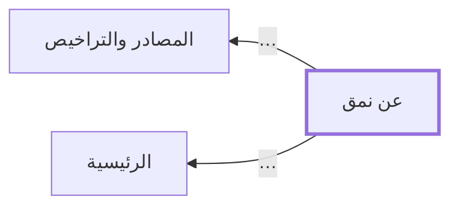

# عن نمق

`mobile/src/app/about.tsx` · [the whole map](../feature-map.md)

## Ways in

- None found in the code.

## What it opens

| Part of the screen | Label | Opens | Code |
| --- | --- | --- | --- |
| `About` | (onPress) | [المصادر والتراخيص](attributions.md) | [screens/info.tsx:31](../../mobile/src/screens/info.tsx#L31) |
| `InfoScreen` | (back) | [الرئيسية](home.md) | [screens/info.tsx:108](../../mobile/src/screens/info.tsx#L108) |

## Sheets

None of its own.
