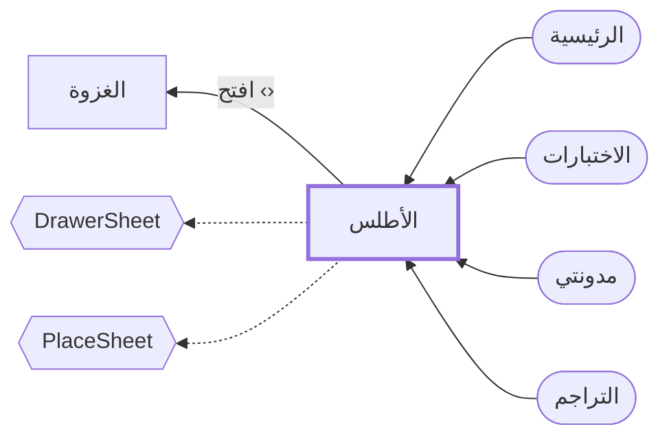

# الأطلس

`mobile/src/app/(tabs)/(tarajim)/atlas.tsx` · [the whole map](../feature-map.md)

## Ways in

- [الرئيسية](home.md)
- [الاختبارات](quizzes.md)
- [مدونتي](library.md)
- [التراجم](tarajim.md)

## What it opens

| Part of the screen | Label | Opens | Code |
| --- | --- | --- | --- |
| `BattleRow` | افتح ‹› | [الغزوة](battle.md) | [screens/atlas.tsx:37](../../mobile/src/screens/atlas.tsx#L37) |
| `AtlasBattle` | افتح ‹› | [الغزوة](battle.md) | [screens/atlas.tsx:58](../../mobile/src/screens/atlas.tsx#L58) |
| `PlaceSheet` | افتح ‹› | [الغزوة](battle.md) | [screens/atlas.tsx:81](../../mobile/src/screens/atlas.tsx#L81) |
| `AtlasScreen` | (pickFound) | [الغزوة](battle.md) | [screens/atlas.tsx:137](../../mobile/src/screens/atlas.tsx#L137) |

## Sheets

- `DrawerSheet`
- `PlaceSheet`
