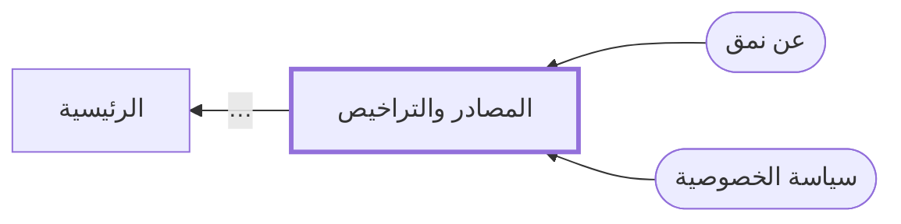

# المصادر والتراخيص

`mobile/src/app/attributions.tsx` · [the whole map](../feature-map.md)

## Ways in

- [عن نمق](about.md)
- [سياسة الخصوصية](privacy.md)

## What it opens

| Part of the screen | Label | Opens | Code |
| --- | --- | --- | --- |
| `About` | (onPress) | [المصادر والتراخيص](attributions.md) | [screens/info.tsx:31](../../mobile/src/screens/info.tsx#L31) |
| `InfoScreen` | (back) | [الرئيسية](home.md) | [screens/info.tsx:104](../../mobile/src/screens/info.tsx#L104) |

## Sheets

None of its own.
