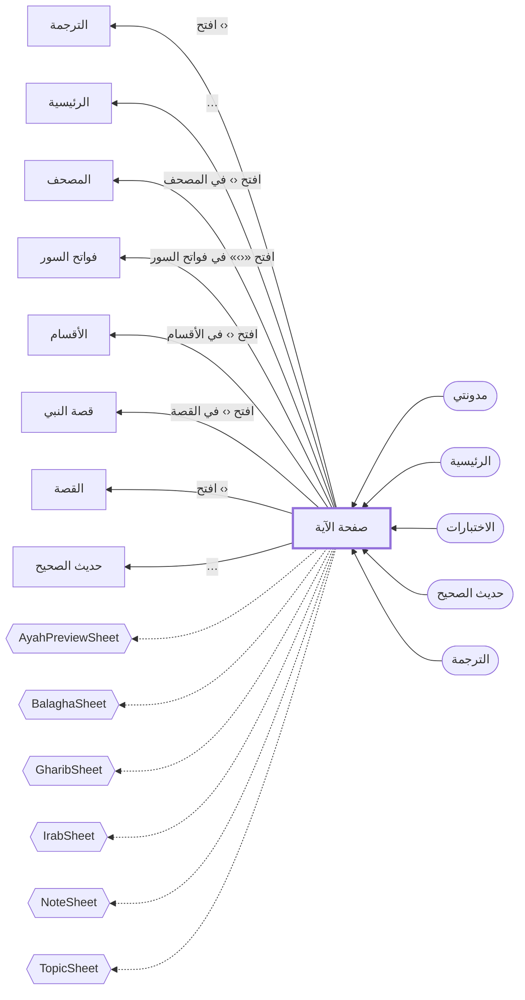

# صفحة الآية

`mobile/src/app/ayah.tsx` · [the whole map](../feature-map.md)

## Ways in

- [مدونتي](library.md)
- [الرئيسية](home.md)
- [الاختبارات](quizzes.md)
- [حديث الصحيح](hadith-sahih.md)
- [الترجمة](person.md)

## What it opens

| Part of the screen | Label | Opens | Code |
| --- | --- | --- | --- |
| `People` | (onPress) | [الترجمة](person.md) | [components/battles/BattleParts.tsx:113](../../mobile/src/components/battles/BattleParts.tsx#L113) |
| `AyahScreen` | (back) | [الرئيسية](home.md) | [screens/ayah.tsx:106](../../mobile/src/screens/ayah.tsx#L106) |
|  | افتح ‹› في المصحف | [المصحف](read.md) | [screens/ayah.tsx:109](../../mobile/src/screens/ayah.tsx#L109) |
|  | سمّع من هذه الآية | [المصحف](read.md) | [screens/ayah.tsx:111](../../mobile/src/screens/ayah.tsx#L111) |
|  | (onJump) | [المصحف](read.md) | [screens/ayah.tsx:139](../../mobile/src/screens/ayah.tsx#L139) |
| `SectionPart` | افتح «‹›» في فواتح السور | [فواتح السور](openings.md) | [screens/ayah.tsx:234](../../mobile/src/screens/ayah.tsx#L234) |
|  | افتح ‹› في الأقسام | [الأقسام](oaths.md) | [screens/ayah.tsx:242](../../mobile/src/screens/ayah.tsx#L242) |
|  | افتح ‹› في القصة | [قصة النبي](prophets-slug.md) | [screens/ayah.tsx:253](../../mobile/src/screens/ayah.tsx#L253) |
|  | افتح ‹› | [القصة](story.md) | [screens/ayah.tsx:262](../../mobile/src/screens/ayah.tsx#L262) |
|  | (onPress) | [حديث الصحيح](hadith-sahih.md) | [screens/ayah.tsx:271](../../mobile/src/screens/ayah.tsx#L271) |
|  | افتح ‹› | [الترجمة](person.md) | [screens/ayah.tsx:289](../../mobile/src/screens/ayah.tsx#L289) |

## Sheets

- `AyahPreviewSheet`
- `BalaghaSheet`
- `GharibSheet`
- `IrabSheet`
- `NoteSheet`
- `TopicSheet`
