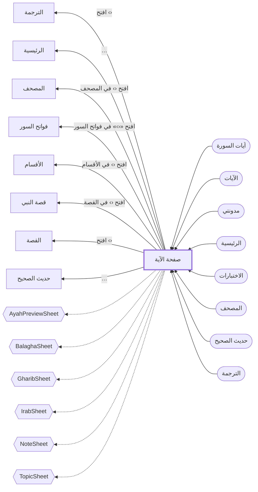

# صفحة الآية

`mobile/src/app/ayah.tsx` · [the whole map](../feature-map.md)

## Ways in

- [آيات السورة](ayat-surah.md)
- [الآيات](ayat.md)
- [مدونتي](library.md)
- [الرئيسية](home.md)
- [الاختبارات](quizzes.md)
- [المصحف](read.md)
- [حديث الصحيح](hadith-sahih.md)
- [الترجمة](person.md)

## What it opens

| Part of the screen | Label | Opens | Code |
| --- | --- | --- | --- |
| `People` | (onPress) | [الترجمة](person.md) | [components/battles/BattleParts.tsx:113](../../mobile/src/components/battles/BattleParts.tsx#L113) |
| `AyahScreen` | (back) | [الرئيسية](home.md) | [screens/ayah.tsx:100](../../mobile/src/screens/ayah.tsx#L100) |
|  | افتح ‹› في المصحف | [المصحف](read.md) | [screens/ayah.tsx:103](../../mobile/src/screens/ayah.tsx#L103) |
|  | سمّع من هذه الآية | [المصحف](read.md) | [screens/ayah.tsx:105](../../mobile/src/screens/ayah.tsx#L105) |
|  | (onJump) | [المصحف](read.md) | [screens/ayah.tsx:133](../../mobile/src/screens/ayah.tsx#L133) |
| `SectionPart` | افتح «‹›» في فواتح السور | [فواتح السور](openings.md) | [screens/ayah.tsx:228](../../mobile/src/screens/ayah.tsx#L228) |
|  | افتح ‹› في الأقسام | [الأقسام](oaths.md) | [screens/ayah.tsx:236](../../mobile/src/screens/ayah.tsx#L236) |
|  | افتح ‹› في القصة | [قصة النبي](prophets-slug.md) | [screens/ayah.tsx:247](../../mobile/src/screens/ayah.tsx#L247) |
|  | افتح ‹› | [القصة](story.md) | [screens/ayah.tsx:256](../../mobile/src/screens/ayah.tsx#L256) |
|  | (onPress) | [حديث الصحيح](hadith-sahih.md) | [screens/ayah.tsx:265](../../mobile/src/screens/ayah.tsx#L265) |
|  | افتح ‹› | [الترجمة](person.md) | [screens/ayah.tsx:283](../../mobile/src/screens/ayah.tsx#L283) |

## Sheets

- `AyahPreviewSheet`
- `BalaghaSheet`
- `GharibSheet`
- `IrabSheet`
- `NoteSheet`
- `TopicSheet`
