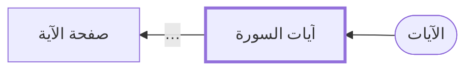

# آيات السورة

`mobile/src/app/(tabs)/(quran)/ayat-surah.tsx` · [the whole map](../feature-map.md)

## Ways in

- [الآيات](ayat.md)

## What it opens

| Part of the screen | Label | Opens | Code |
| --- | --- | --- | --- |
| `AyahListRow` | ‹›: ‹› | [صفحة الآية](ayah.md) | [components/AyahListRow.tsx:32](../../mobile/src/components/AyahListRow.tsx#L32) |

## Sheets

None of its own.
