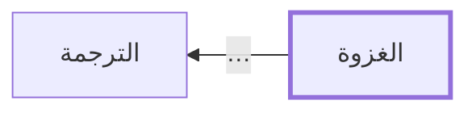

# الغزوة

`mobile/src/app/(tabs)/(tarajim)/battle.tsx` · [the whole map](../feature-map.md)

## Ways in

- [الرئيسية](home.md)
- [الاختبارات](quizzes.md)
- [مدونتي](library.md)
- [حياتهم جنبًا إلى جنب](life.md)
- [الترجمة](person.md)
- [غرفة الاختبار الجماعي](quiz-party-code.md)
- [الاختبار](quiz-play.md)
- [البحث](search.md)
- [القرآن](quran.md)
- [الغزوات والمعارك](battles.md)
- [الأطلس](atlas.md)
- [قصص السيرة](stories.md)
- [الصلات](ties.md)

## What it opens

| Part of the screen | Label | Opens | Code |
| --- | --- | --- | --- |
| `People` | (onPress) | [الترجمة](person.md) | [components/battles/BattleParts.tsx:113](../../mobile/src/components/battles/BattleParts.tsx#L113) |

## Sheets

None of its own.
