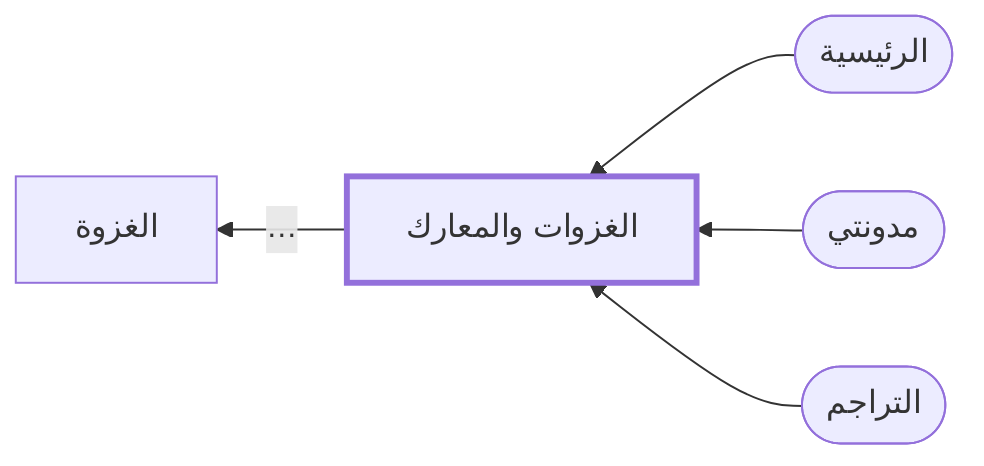

# الغزوات والمعارك

`mobile/src/app/(tabs)/(tarajim)/battles.tsx` · [the whole map](../feature-map.md)

## Ways in

- [الرئيسية](home.md)
- [مدونتي](library.md)
- [التراجم](tarajim.md)

## What it opens

| Part of the screen | Label | Opens | Code |
| --- | --- | --- | --- |
| `Station` | (onPress) | [الغزوة](battle.md) | [components/battles/BattleLine.tsx:30](../../mobile/src/components/battles/BattleLine.tsx#L30) |

## Sheets

None of its own.
