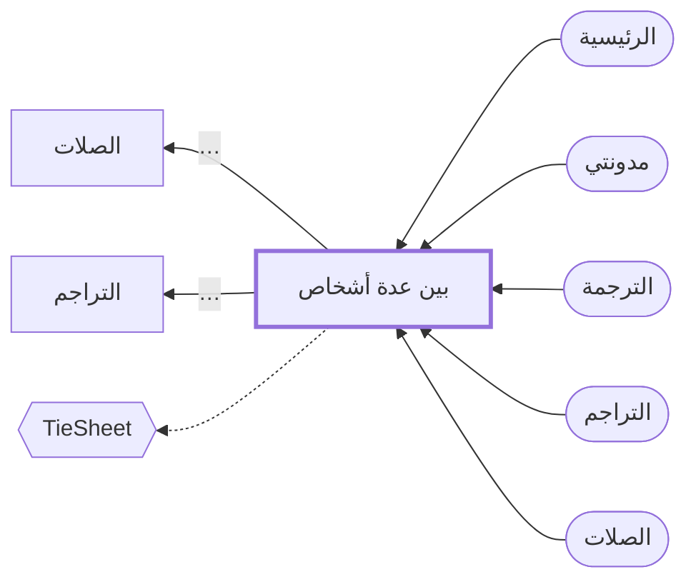

# بين عدة أشخاص

`mobile/src/app/(tabs)/(tarajim)/between.tsx` · [the whole map](../feature-map.md)

## Ways in

- [الرئيسية](home.md)
- [مدونتي](library.md)
- [الترجمة](person.md)
- [التراجم](tarajim.md)
- [الصلات](ties.md)

## What it opens

| Part of the screen | Label | Opens | Code |
| --- | --- | --- | --- |
| `TiesChain` | (open) | [الصلات](ties.md) | [components/TiesChain.tsx:135](../../mobile/src/components/TiesChain.tsx#L135) |
| `BetweenScreen` | (back) | [التراجم](tarajim.md) | [screens/between.tsx:34](../../mobile/src/screens/between.tsx#L34) |

## Sheets

- `TieSheet`
