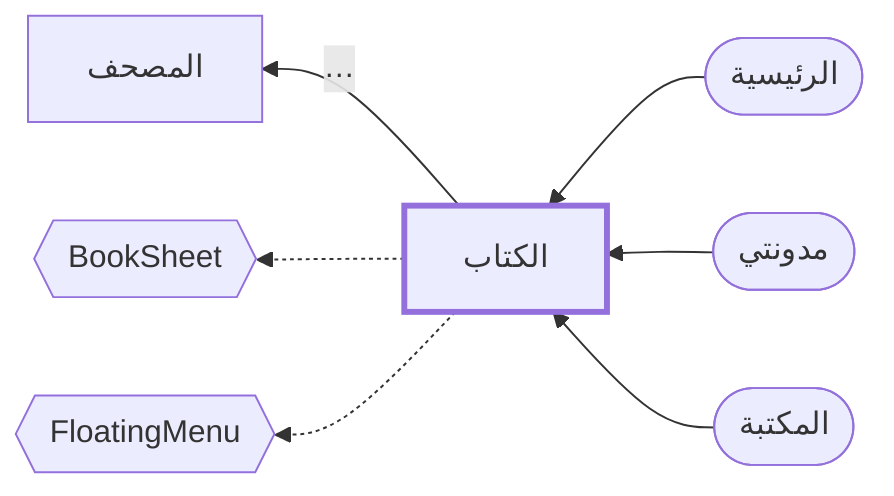

# الكتاب

`mobile/src/app/(tabs)/(library)/book.tsx` · [the whole map](../feature-map.md)

## Ways in

- [الرئيسية](home.md)
- [مدونتي](library.md)
- [المكتبة](books.md)

## What it opens

| Part of the screen | Label | Opens | Code |
| --- | --- | --- | --- |
| `BookReader` | (openAyah) | [المصحف](read.md) | [screens/book.tsx:122](../../mobile/src/screens/book.tsx#L122) |

## Sheets

- `BookSheet`
- `FloatingMenu`
