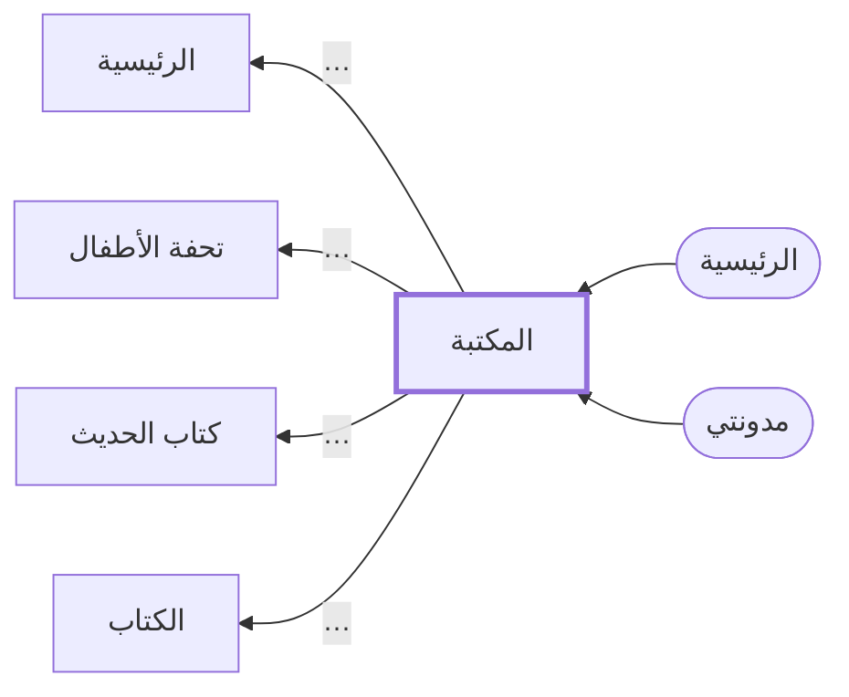

# المكتبة

`mobile/src/app/(tabs)/(library)/books.tsx` · [the whole map](../feature-map.md)

## Ways in

- [الرئيسية](home.md)
- [مدونتي](library.md)

## What it opens

| Part of the screen | Label | Opens | Code |
| --- | --- | --- | --- |
| `LibraryScreen` | (back) | [الرئيسية](home.md) | [screens/books.tsx:44](../../mobile/src/screens/books.tsx#L44) |
|  | (onPress) | [تحفة الأطفال](tuhfa.md) | [screens/books.tsx:53](../../mobile/src/screens/books.tsx#L53) |
| `BookCard` | (open) | [كتاب الحديث](hadith-book.md) | [screens/books.tsx:62](../../mobile/src/screens/books.tsx#L62) |
|  | (open) | [الكتاب](book.md) | [screens/books.tsx:63](../../mobile/src/screens/books.tsx#L63) |

## Sheets

None of its own.
