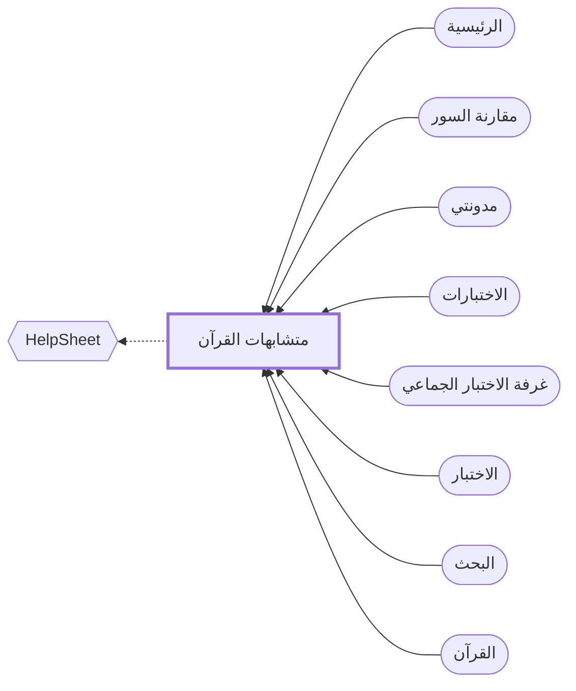

# متشابهات القرآن

`mobile/src/app/(tabs)/(quran)/branches.tsx` · [the whole map](../feature-map.md)

## Ways in

- [الرئيسية](home.md)
- [مقارنة السور](compare.md)
- [مدونتي](library.md)
- [الاختبارات](quizzes.md)
- [غرفة الاختبار الجماعي](quiz-party-code.md)
- [الاختبار](quiz-play.md)
- [البحث](search.md)
- [القرآن](quran.md)

## What it opens

Nothing of its own: only the bars every screen has.

## Sheets

- `HelpSheet`
