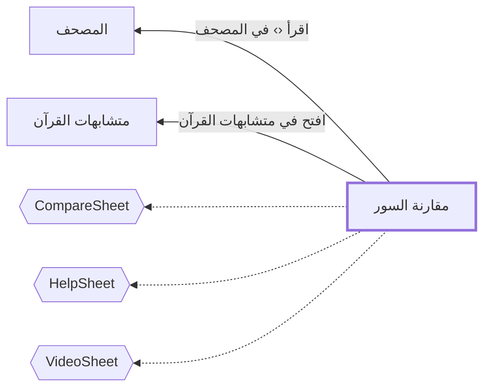

# مقارنة السور

`mobile/src/app/(tabs)/(quran)/compare.tsx` · [the whole map](../feature-map.md)

## Ways in

- [الرئيسية](home.md)
- [مدونتي](library.md)
- [قصص الأنبياء](prophets.md)
- [قصة النبي](prophets-slug.md)
- [الاختبارات](quizzes.md)
- [غرفة الاختبار الجماعي](quiz-party-code.md)
- [الاختبار](quiz-play.md)
- [البحث](search.md)
- [القرآن](quran.md)

## What it opens

| Part of the screen | Label | Opens | Code |
| --- | --- | --- | --- |
| `SideHead` | (onPress) | [المصحف](read.md) | [components/CompareCard.tsx:101](../../mobile/src/components/CompareCard.tsx#L101) |
|  | افتح في متشابهات القرآن | [متشابهات القرآن](branches.md) | [components/CompareCard.tsx:102](../../mobile/src/components/CompareCard.tsx#L102) |
| `LaneHead` | اقرأ ‹› في المصحف | [المصحف](read.md) | [components/CompareCard.tsx:113](../../mobile/src/components/CompareCard.tsx#L113) |
|  | افتح في متشابهات القرآن | [متشابهات القرآن](branches.md) | [components/CompareCard.tsx:114](../../mobile/src/components/CompareCard.tsx#L114) |
| `CompareCard` | اقرأ ‹› في المصحف | [المصحف](read.md) | [components/CompareCard.tsx:346](../../mobile/src/components/CompareCard.tsx#L346) |
|  | افتح في متشابهات القرآن | [متشابهات القرآن](branches.md) | [components/CompareCard.tsx:353](../../mobile/src/components/CompareCard.tsx#L353) |

## Sheets

- `CompareSheet`
- `HelpSheet`
- `VideoSheet`
