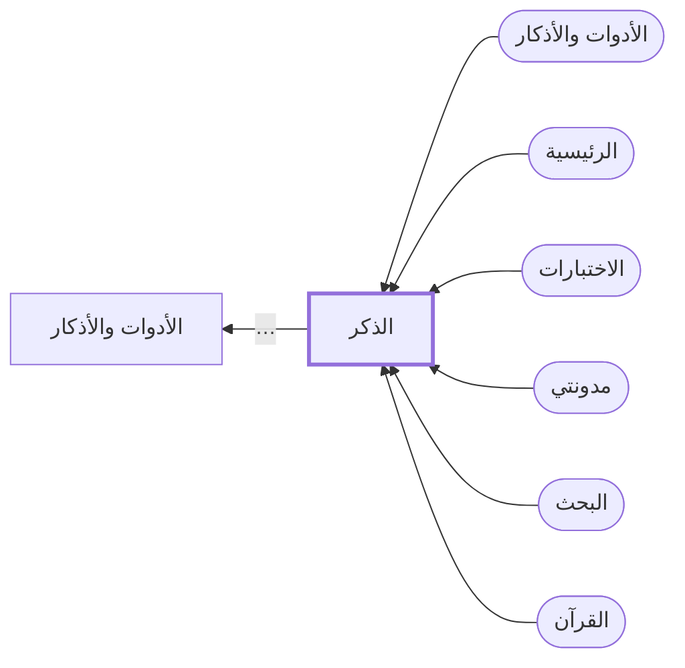

# الذكر

`mobile/src/app/(tabs)/(home)/dhikr.tsx` · [the whole map](../feature-map.md)

## Ways in

- [الأدوات والأذكار](utilities.md)
- [الرئيسية](home.md)
- [الاختبارات](quizzes.md)
- [مدونتي](library.md)
- [البحث](search.md)
- [القرآن](quran.md)

## What it opens

| Part of the screen | Label | Opens | Code |
| --- | --- | --- | --- |
| `DhikrScreen` | (back) | [الأدوات والأذكار](utilities.md) | [screens/dhikr.tsx:75](../../mobile/src/screens/dhikr.tsx#L75) |

## Sheets

None of its own.
