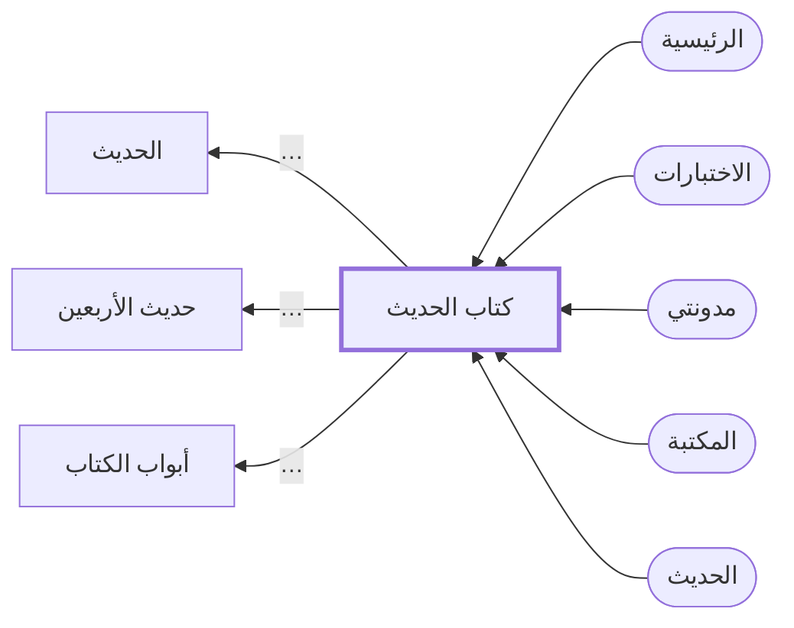

# كتاب الحديث

`mobile/src/app/(tabs)/(hadith)/hadith-book.tsx` · [the whole map](../feature-map.md)

## Ways in

- [الرئيسية](home.md)
- [الاختبارات](quizzes.md)
- [مدونتي](library.md)
- [المكتبة](books.md)
- [الحديث](hadith.md)

## What it opens

| Part of the screen | Label | Opens | Code |
| --- | --- | --- | --- |
| `HadithBookScreen` | (back) | [الحديث](hadith.md) | [screens/hadithBook.tsx:27](../../mobile/src/screens/hadithBook.tsx#L27) |
|  | (onPress) | [حديث الأربعين](hadith-forty.md) | [screens/hadithBook.tsx:35](../../mobile/src/screens/hadithBook.tsx#L35) |
|  | (onOpenKitab) | [أبواب الكتاب](hadith-kitab.md) | [screens/hadithBook.tsx:45](../../mobile/src/screens/hadithBook.tsx#L45) |
|  | (onOpen) | [أبواب الكتاب](hadith-kitab.md) | [screens/hadithBook.tsx:50](../../mobile/src/screens/hadithBook.tsx#L50) |
|  | (onOpenBab) | [أبواب الكتاب](hadith-kitab.md) | [screens/hadithBook.tsx:50](../../mobile/src/screens/hadithBook.tsx#L50) |

## Sheets

None of its own.
