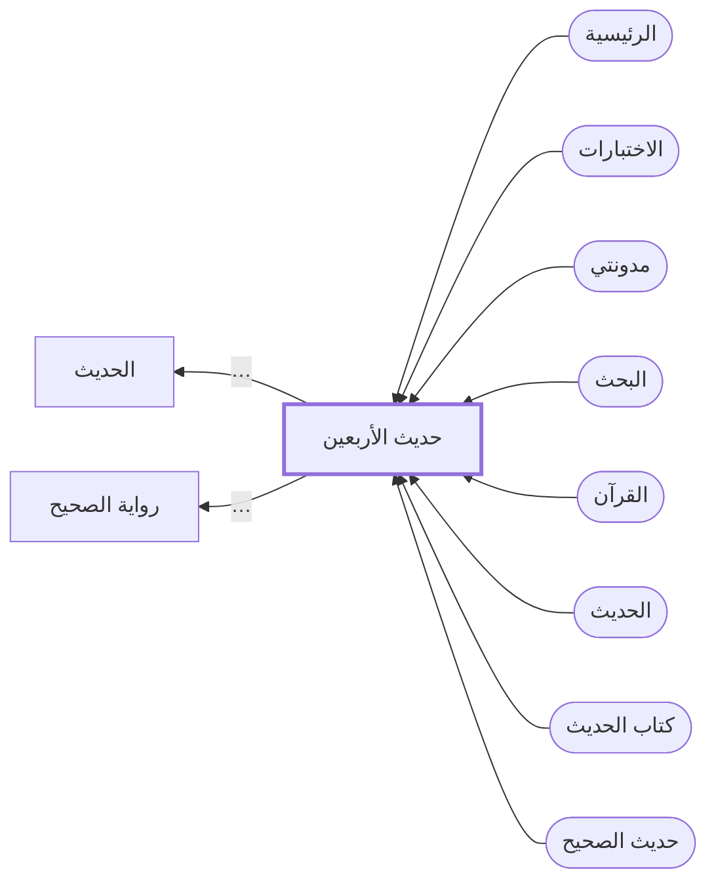

# حديث الأربعين

`mobile/src/app/(tabs)/(hadith)/hadith-forty.tsx` · [the whole map](../feature-map.md)

## Ways in

- [الرئيسية](home.md)
- [الاختبارات](quizzes.md)
- [مدونتي](library.md)
- [البحث](search.md)
- [القرآن](quran.md)
- [الحديث](hadith.md)
- [كتاب الحديث](hadith-book.md)
- [حديث الصحيح](hadith-sahih.md)

## What it opens

| Part of the screen | Label | Opens | Code |
| --- | --- | --- | --- |
| `HadithFortyScreen` | (back) | [الحديث](hadith.md) | [screens/hadithForty.tsx:157](../../mobile/src/screens/hadithForty.tsx#L157) |
|  | (unit) | [رواية الصحيح](hadith-unit.md) | [screens/hadithForty.tsx:159](../../mobile/src/screens/hadithForty.tsx#L159) |

## Sheets

None of its own.
