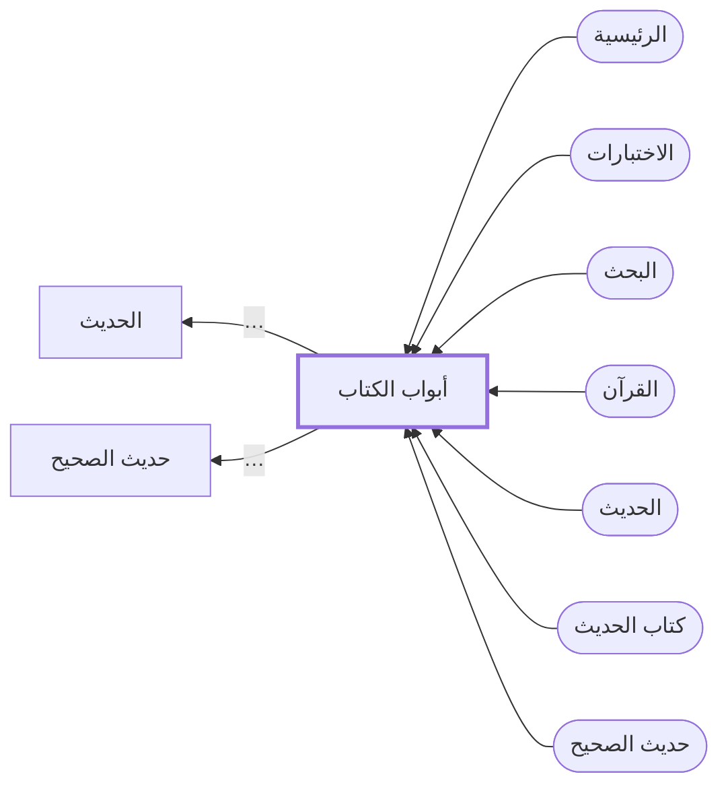

# أبواب الكتاب

`mobile/src/app/(tabs)/(hadith)/hadith-kitab.tsx` · [the whole map](../feature-map.md)

## Ways in

- [الرئيسية](home.md)
- [الاختبارات](quizzes.md)
- [البحث](search.md)
- [القرآن](quran.md)
- [الحديث](hadith.md)
- [كتاب الحديث](hadith-book.md)
- [حديث الصحيح](hadith-sahih.md)

## What it opens

| Part of the screen | Label | Opens | Code |
| --- | --- | --- | --- |
| `BabRow` | (onPress) | [أبواب الكتاب](hadith-kitab.md) | [screens/hadithKitab.tsx:39](../../mobile/src/screens/hadithKitab.tsx#L39) |
| `KitabIndex` | (back) | [الحديث](hadith.md) | [screens/hadithKitab.tsx:65](../../mobile/src/screens/hadithKitab.tsx#L65) |
| `BabPage` | (back) | [الحديث](hadith.md) | [screens/hadithKitab.tsx:103](../../mobile/src/screens/hadithKitab.tsx#L103) |
|  | (go) | [أبواب الكتاب](hadith-kitab.md) | [screens/hadithKitab.tsx:104](../../mobile/src/screens/hadithKitab.tsx#L104) |
|  | ‹›‹› | [أبواب الكتاب](hadith-kitab.md) | [screens/hadithKitab.tsx:114](../../mobile/src/screens/hadithKitab.tsx#L114) |
|  | (onPress) | [حديث الصحيح](hadith-sahih.md) | [screens/hadithKitab.tsx:127](../../mobile/src/screens/hadithKitab.tsx#L127) |
| `HadithKitabScreen` | (back) | [الحديث](hadith.md) | [screens/hadithKitab.tsx:143](../../mobile/src/screens/hadithKitab.tsx#L143) |

## Sheets

None of its own.
