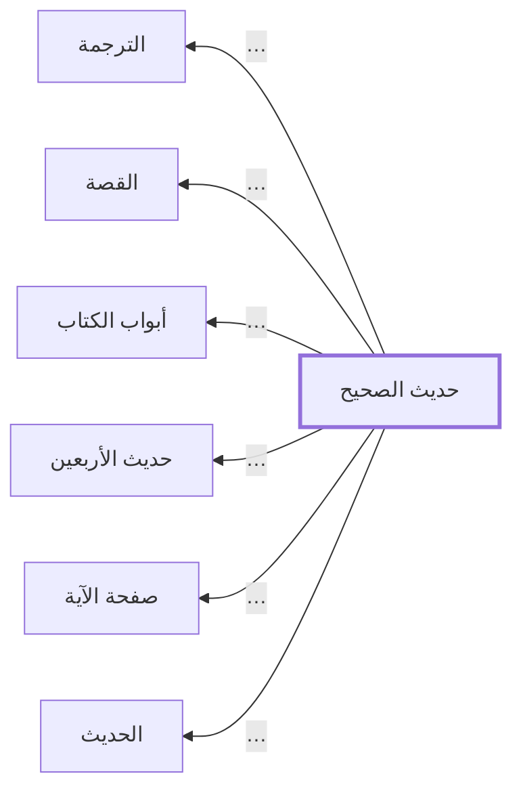

# حديث الصحيح

`mobile/src/app/(tabs)/(hadith)/hadith-sahih.tsx` · [the whole map](../feature-map.md)

## Ways in

- [الرئيسية](home.md)
- [مدونتي](library.md)
- [الترجمة](person.md)
- [الاختبارات](quizzes.md)
- [غرفة الاختبار الجماعي](quiz-party-code.md)
- [الاختبار](quiz-play.md)
- [البحث](search.md)
- [القرآن](quran.md)
- [مشاهد](lataif.md)
- [المشهد](scene.md)
- [صفحة الآية](ayah.md)
- [الحديث](hadith.md)
- [أبواب الكتاب](hadith-kitab.md)
- [القصة](story.md)

## What it opens

| Part of the screen | Label | Opens | Code |
| --- | --- | --- | --- |
| `People` | (onPress) | [الترجمة](person.md) | [components/battles/BattleParts.tsx:113](../../mobile/src/components/battles/BattleParts.tsx#L113) |
| `StoryLinkRow` | (onPress) | [القصة](story.md) | [components/stories/StoryParts.tsx:131](../../mobile/src/components/stories/StoryParts.tsx#L131) |
| `SahihPage` | ‹›‹› | [أبواب الكتاب](hadith-kitab.md) | [screens/hadithSahih.tsx:42](../../mobile/src/screens/hadithSahih.tsx#L42) |
|  | ‹›‹› | [أبواب الكتاب](hadith-kitab.md) | [screens/hadithSahih.tsx:42](../../mobile/src/screens/hadithSahih.tsx#L42) |
|  | (onOpen) | [حديث الصحيح](hadith-sahih.md) | [screens/hadithSahih.tsx:53](../../mobile/src/screens/hadithSahih.tsx#L53) |
|  | (onPress) | [حديث الأربعين](hadith-forty.md) | [screens/hadithSahih.tsx:55](../../mobile/src/screens/hadithSahih.tsx#L55) |
| `InHadith` | ‹› · ‹› | [صفحة الآية](ayah.md) | [screens/hadithSahih.tsx:76](../../mobile/src/screens/hadithSahih.tsx#L76) |
| `HadithSahihScreen` | (back) | [الحديث](hadith.md) | [screens/hadithSahih.tsx:113](../../mobile/src/screens/hadithSahih.tsx#L113) |

## Sheets

None of its own.
