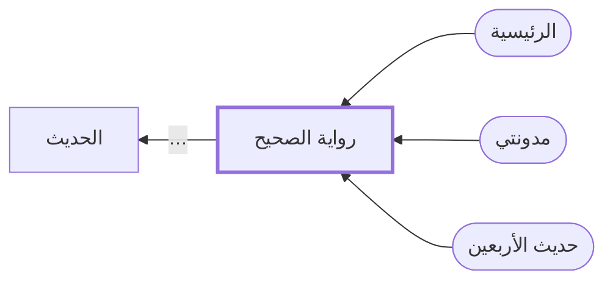

# رواية الصحيح

`mobile/src/app/(tabs)/(hadith)/hadith-unit.tsx` · [the whole map](../feature-map.md)

## Ways in

- [الرئيسية](home.md)
- [مدونتي](library.md)
- [حديث الأربعين](hadith-forty.md)

## What it opens

| Part of the screen | Label | Opens | Code |
| --- | --- | --- | --- |
| `HadithUnitScreen` | (back) | [الحديث](hadith.md) | [screens/hadithUnit.tsx:55](../../mobile/src/screens/hadithUnit.tsx#L55) |
|  | (open) | [رواية الصحيح](hadith-unit.md) | [screens/hadithUnit.tsx:59](../../mobile/src/screens/hadithUnit.tsx#L59) |

## Sheets

None of its own.
