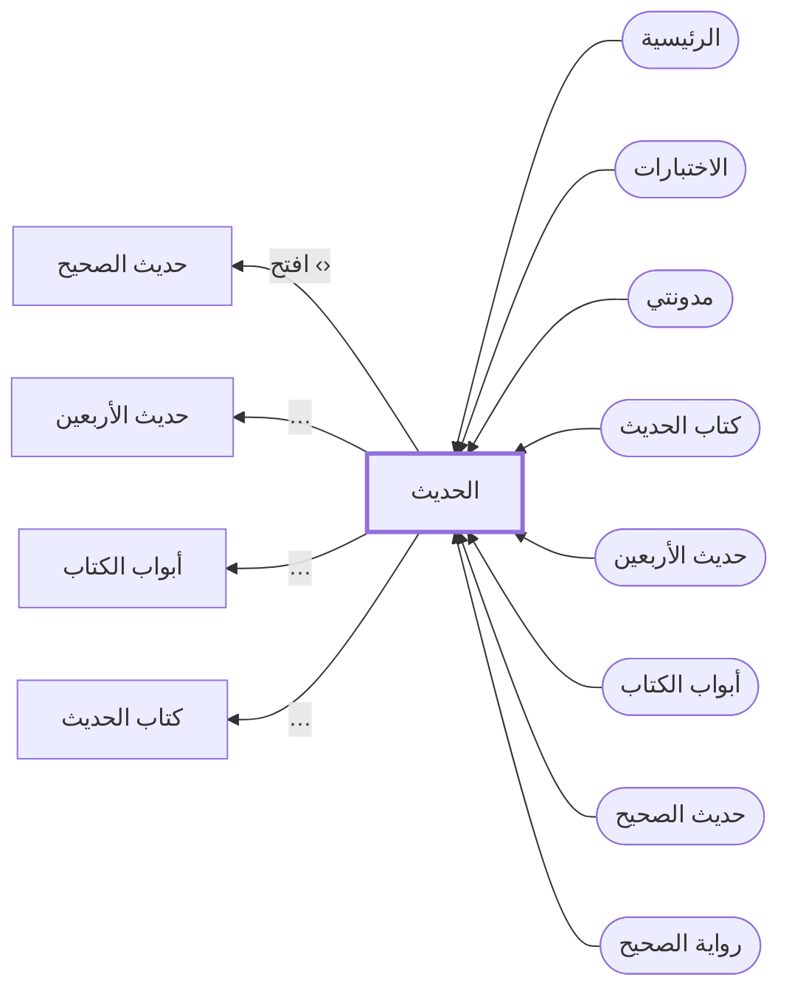

# الحديث

`mobile/src/app/(tabs)/(hadith)/hadith.tsx` · [the whole map](../feature-map.md)

## Ways in

- The tab bar's «الحديث».
- [الرئيسية](home.md)
- [الاختبارات](quizzes.md)
- [مدونتي](library.md)
- [كتاب الحديث](hadith-book.md)
- [حديث الأربعين](hadith-forty.md)
- [أبواب الكتاب](hadith-kitab.md)
- [حديث الصحيح](hadith-sahih.md)
- [رواية الصحيح](hadith-unit.md)

## What it opens

| Part of the screen | Label | Opens | Code |
| --- | --- | --- | --- |
| `ContinueCard` | افتح ‹› | [حديث الصحيح](hadith-sahih.md) | [screens/hadith.tsx:34](../../mobile/src/screens/hadith.tsx#L34) |
| `FortyShape` | (onOpen) | [حديث الأربعين](hadith-forty.md) | [screens/hadith.tsx:52](../../mobile/src/screens/hadith.tsx#L52) |
| `Hit` | (onPress) | [حديث الصحيح](hadith-sahih.md) | [screens/hadith.tsx:67](../../mobile/src/screens/hadith.tsx#L67) |
|  | (onPress) | [أبواب الكتاب](hadith-kitab.md) | [screens/hadith.tsx:67](../../mobile/src/screens/hadith.tsx#L67) |
|  | (onPress) | [أبواب الكتاب](hadith-kitab.md) | [screens/hadith.tsx:67](../../mobile/src/screens/hadith.tsx#L67) |
| `HadithScreen` | (onPress) | [حديث الأربعين](hadith-forty.md) | [screens/hadith.tsx:115](../../mobile/src/screens/hadith.tsx#L115) |
|  | (onOpenBook) | [كتاب الحديث](hadith-book.md) | [screens/hadith.tsx:129](../../mobile/src/screens/hadith.tsx#L129) |
|  | (onOpenKitab) | [أبواب الكتاب](hadith-kitab.md) | [screens/hadith.tsx:129](../../mobile/src/screens/hadith.tsx#L129) |
|  | (onOpenBook) | [كتاب الحديث](hadith-book.md) | [screens/hadith.tsx:133](../../mobile/src/screens/hadith.tsx#L133) |

## Sheets

None of its own.
