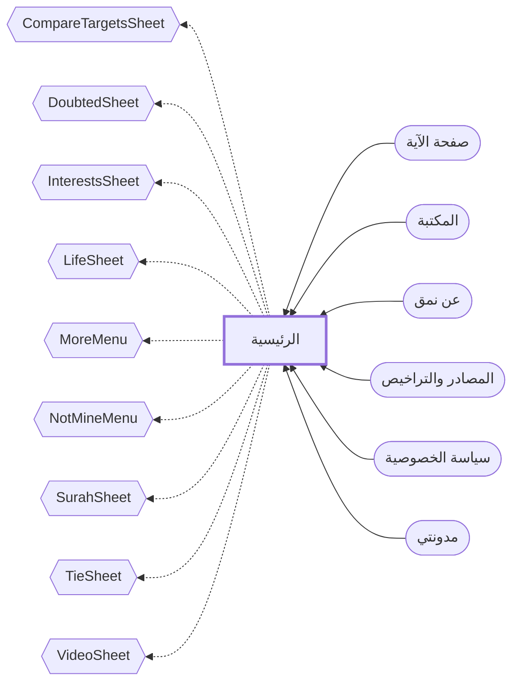

# الرئيسية

`mobile/src/app/(tabs)/(home)/index.tsx` · [the whole map](../feature-map.md)

## Ways in

- The tab bar's «الرئيسية».
- [صفحة الآية](ayah.md)
- [المكتبة](books.md)
- [عن نمق](about.md)
- [المصادر والتراخيص](attributions.md)
- [سياسة الخصوصية](privacy.md)
- [مدونتي](library.md)

## What it opens

| Part of the screen | Label | Opens | Code |
| --- | --- | --- | --- |
| `HomeScreen` | (search) | [البحث](search.md) | [app/(tabs)/(home)/index.tsx:78](../../mobile/src/app/(tabs)/(home)/index.tsx#L78) |
| `SideHead` | (onPress) | [المصحف](read.md) | [components/CompareCard.tsx:111](../../mobile/src/components/CompareCard.tsx#L111) |
|  | افتح في متشابهات القرآن | [متشابهات القرآن](branches.md) | [components/CompareCard.tsx:112](../../mobile/src/components/CompareCard.tsx#L112) |
| `LaneHead` | اقرأ ‹› في المصحف | [المصحف](read.md) | [components/CompareCard.tsx:124](../../mobile/src/components/CompareCard.tsx#L124) |
|  | افتح في متشابهات القرآن | [متشابهات القرآن](branches.md) | [components/CompareCard.tsx:125](../../mobile/src/components/CompareCard.tsx#L125) |
| `CompareCard` | اقرأ ‹› في المصحف | [المصحف](read.md) | [components/CompareCard.tsx:376](../../mobile/src/components/CompareCard.tsx#L376) |
|  | افتح في متشابهات القرآن | [متشابهات القرآن](branches.md) | [components/CompareCard.tsx:385](../../mobile/src/components/CompareCard.tsx#L385) |
| `DarkSeaActions` | افتح مشهد ‹› | [المشهد](scene.md) | [components/DarkSea.tsx:256](../../mobile/src/components/DarkSea.tsx#L256) |
|  | افتح ‹› في المصحف | [المصحف](read.md) | [components/DarkSea.tsx:257](../../mobile/src/components/DarkSea.tsx#L257) |
| `EventPlaces` | افتح ‹› في المصحف | [المصحف](read.md) | [components/EventPlaces.tsx:101](../../mobile/src/components/EventPlaces.tsx#L101) |
|  | (onPick) | [مقارنة السور](compare.md) | [components/EventPlaces.tsx:117](../../mobile/src/components/EventPlaces.tsx#L117) |
| `CompareButton` | قارن ‹› | [مقارنة السور](compare.md) | [components/EventPlaces.tsx:129](../../mobile/src/components/EventPlaces.tsx#L129) |
| `BUTTONS` | القبلة | [الأدوات والأذكار](utilities.md) | [components/HomeButtons.tsx:15](../../mobile/src/components/HomeButtons.tsx#L15) |
|  | الأذكار | [الأدوات والأذكار](utilities.md) | [components/HomeButtons.tsx:16](../../mobile/src/components/HomeButtons.tsx#L16) |
|  | المكتبة | [المكتبة](books.md) | [components/HomeButtons.tsx:17](../../mobile/src/components/HomeButtons.tsx#L17) |
|  | مشاهد | [مشاهد](lataif.md) | [components/HomeButtons.tsx:18](../../mobile/src/components/HomeButtons.tsx#L18) |
|  | مدونتي | [مدونتي](library.md) | [components/HomeButtons.tsx:19](../../mobile/src/components/HomeButtons.tsx#L19) |
| `ContinueReading` | (read) | [المصحف](read.md) | [components/HomeFeed.tsx:326](../../mobile/src/components/HomeFeed.tsx#L326) |
|  | ابدأ القراءة | [القرآن](quran.md) | [components/HomeFeed.tsx:330](../../mobile/src/components/HomeFeed.tsx#L330) |
| `PairPost` | (compare) | [مقارنة السور](compare.md) | [components/HomeFeed.tsx:345](../../mobile/src/components/HomeFeed.tsx#L345) |
|  | آيتان متشابهتان | [مقارنة السور](compare.md) | [components/HomeFeed.tsx:352](../../mobile/src/components/HomeFeed.tsx#L352) |
| `ForgottenPost` | افتح صفحة الآية | [صفحة الآية](ayah.md) | [components/HomeFeed.tsx:415](../../mobile/src/components/HomeFeed.tsx#L415) |
|  | افتح ما نسيته | [مدونتي](library.md) | [components/HomeFeed.tsx:417](../../mobile/src/components/HomeFeed.tsx#L417) |
|  | (head) | [الاختبارات](quizzes.md) | [components/HomeFeed.tsx:417](../../mobile/src/components/HomeFeed.tsx#L417) |
| `ReciteAction` | تسميع | [المصحف](read.md) | [components/HomeFeed.tsx:463](../../mobile/src/components/HomeFeed.tsx#L463) |
| `QuizPost` | (open) | [الاختبارات](quizzes.md) | [components/HomeFeed.tsx:571](../../mobile/src/components/HomeFeed.tsx#L571) |
|  | افتح ما يشرح الجواب | [الترجمة](person.md) | [components/HomeFeed.tsx:573](../../mobile/src/components/HomeFeed.tsx#L573) |
|  | افتح ما يشرح الجواب | [متشابهات القرآن](branches.md) | [components/HomeFeed.tsx:573](../../mobile/src/components/HomeFeed.tsx#L573) |
|  | افتح ما يشرح الجواب | [مقارنة السور](compare.md) | [components/HomeFeed.tsx:573](../../mobile/src/components/HomeFeed.tsx#L573) |
|  | افتح ما يشرح الجواب | [الأطلس](atlas.md) | [components/HomeFeed.tsx:573](../../mobile/src/components/HomeFeed.tsx#L573) |
|  | افتح ما يشرح الجواب | [قصة النبي](prophets-slug.md) | [components/HomeFeed.tsx:573](../../mobile/src/components/HomeFeed.tsx#L573) |
|  | افتح ما يشرح الجواب | [النسب](nasab.md) | [components/HomeFeed.tsx:573](../../mobile/src/components/HomeFeed.tsx#L573) |
|  | افتح ما يشرح الجواب | [المصطلح](term.md) | [components/HomeFeed.tsx:573](../../mobile/src/components/HomeFeed.tsx#L573) |
|  | افتح ما يشرح الجواب | [حديث الأربعين](hadith-forty.md) | [components/HomeFeed.tsx:573](../../mobile/src/components/HomeFeed.tsx#L573) |
|  | افتح ما يشرح الجواب | [كتاب الحديث](hadith-book.md) | [components/HomeFeed.tsx:573](../../mobile/src/components/HomeFeed.tsx#L573) |
|  | افتح ما يشرح الجواب | [أبواب الكتاب](hadith-kitab.md) | [components/HomeFeed.tsx:573](../../mobile/src/components/HomeFeed.tsx#L573) |
|  | افتح ما يشرح الجواب | [الحديث](hadith.md) | [components/HomeFeed.tsx:573](../../mobile/src/components/HomeFeed.tsx#L573) |
|  | افتح ما يشرح الجواب | [القصة](story.md) | [components/HomeFeed.tsx:573](../../mobile/src/components/HomeFeed.tsx#L573) |
|  | افتح ما يشرح الجواب | [الغزوة](battle.md) | [components/HomeFeed.tsx:573](../../mobile/src/components/HomeFeed.tsx#L573) |
|  | افتح ما يشرح الجواب | [المصحف](read.md) | [components/HomeFeed.tsx:573](../../mobile/src/components/HomeFeed.tsx#L573) |
|  | افتح ما يشرح الجواب | [تحفة الأطفال](tuhfa.md) | [components/HomeFeed.tsx:573](../../mobile/src/components/HomeFeed.tsx#L573) |
|  | افتح ما يشرح الجواب | [الذكر](dhikr.md) | [components/HomeFeed.tsx:573](../../mobile/src/components/HomeFeed.tsx#L573) |
|  | افتح ما يشرح الجواب | [ترتيب السور](order.md) | [components/HomeFeed.tsx:573](../../mobile/src/components/HomeFeed.tsx#L573) |
| `TarajimPost` | (open) | [الترجمة](person.md) | [components/HomeFeed.tsx:617](../../mobile/src/components/HomeFeed.tsx#L617) |
|  | من التراجم | [التراجم](tarajim.md) | [components/HomeFeed.tsx:619](../../mobile/src/components/HomeFeed.tsx#L619) |
| `TiePost` | (open) | [بين عدة أشخاص](between.md) | [components/HomeFeed.tsx:641](../../mobile/src/components/HomeFeed.tsx#L641) |
|  | صلة | [التراجم](tarajim.md) | [components/HomeFeed.tsx:643](../../mobile/src/components/HomeFeed.tsx#L643) |
| `NamePost` | (open) | [الترجمة](person.md) | [components/HomeFeed.tsx:667](../../mobile/src/components/HomeFeed.tsx#L667) |
|  | كنية وصاحبها | [التراجم](tarajim.md) | [components/HomeFeed.tsx:670](../../mobile/src/components/HomeFeed.tsx#L670) |
| `LifePost` | (open) | [الترجمة](person.md) | [components/HomeFeed.tsx:691](../../mobile/src/components/HomeFeed.tsx#L691) |
|  | من حياته | [الترجمة](person.md) | [components/HomeFeed.tsx:693](../../mobile/src/components/HomeFeed.tsx#L693) |
| `NasabPost` | (open) | [النسب](nasab.md) | [components/HomeFeed.tsx:713](../../mobile/src/components/HomeFeed.tsx#L713) |
|  | (open) | [الترجمة](person.md) | [components/HomeFeed.tsx:715](../../mobile/src/components/HomeFeed.tsx#L715) |
| `TiesPost` | (open) | [الصلات](ties.md) | [components/HomeFeed.tsx:730](../../mobile/src/components/HomeFeed.tsx#L730) |
|  | (open) | [الترجمة](person.md) | [components/HomeFeed.tsx:732](../../mobile/src/components/HomeFeed.tsx#L732) |
|  | (onPick) | [الترجمة](person.md) | [components/HomeFeed.tsx:736](../../mobile/src/components/HomeFeed.tsx#L736) |
| `GroupPost` | (open) | [بين عدة أشخاص](between.md) | [components/HomeFeed.tsx:760](../../mobile/src/components/HomeFeed.tsx#L760) |
|  | (open) | [التراجم](tarajim.md) | [components/HomeFeed.tsx:762](../../mobile/src/components/HomeFeed.tsx#L762) |
| `LivesPost` | (open) | [حياتهم جنبًا إلى جنب](life.md) | [components/HomeFeed.tsx:781](../../mobile/src/components/HomeFeed.tsx#L781) |
|  | حياتهما | [التراجم](tarajim.md) | [components/HomeFeed.tsx:783](../../mobile/src/components/HomeFeed.tsx#L783) |
| `MeetPost` | (open) | [النسب](nasab.md) | [components/HomeFeed.tsx:803](../../mobile/src/components/HomeFeed.tsx#L803) |
|  | أين يلتقي نسبهما؟ | [التراجم](tarajim.md) | [components/HomeFeed.tsx:806](../../mobile/src/components/HomeFeed.tsx#L806) |
| `RingPost` | (go) | [الترجمة](person.md) | [components/HomeFeed.tsx:832](../../mobile/src/components/HomeFeed.tsx#L832) |
|  | (open) | [الترجمة](person.md) | [components/HomeFeed.tsx:848](../../mobile/src/components/HomeFeed.tsx#L848) |
|  | (open) | [كتاب الحديث](hadith-book.md) | [components/HomeFeed.tsx:849](../../mobile/src/components/HomeFeed.tsx#L849) |
|  | (open) | [التراجم](tarajim.md) | [components/HomeFeed.tsx:849](../../mobile/src/components/HomeFeed.tsx#L849) |
|  | (open) | [الصلات](ties.md) | [components/HomeFeed.tsx:850](../../mobile/src/components/HomeFeed.tsx#L850) |
|  | (open) | [كل التراجم](people.md) | [components/HomeFeed.tsx:851](../../mobile/src/components/HomeFeed.tsx#L851) |
|  | (open) | [حديث الصحيح](hadith-sahih.md) | [components/HomeFeed.tsx:852](../../mobile/src/components/HomeFeed.tsx#L852) |
| `BattlePost` | (open) | [الغزوة](battle.md) | [components/HomeFeed.tsx:880](../../mobile/src/components/HomeFeed.tsx#L880) |
|  | (open) | [الغزوات والمعارك](battles.md) | [components/HomeFeed.tsx:882](../../mobile/src/components/HomeFeed.tsx#L882) |
| `BattleYearPost` | (toYear) | [الأطلس](atlas.md) | [components/HomeFeed.tsx:905](../../mobile/src/components/HomeFeed.tsx#L905) |
|  | من الأطلس | [الأطلس](atlas.md) | [components/HomeFeed.tsx:910](../../mobile/src/components/HomeFeed.tsx#L910) |
|  | افتح ‹› | [الغزوة](battle.md) | [components/HomeFeed.tsx:920](../../mobile/src/components/HomeFeed.tsx#L920) |
| `ArmiesPost` | الجيشان في الغزوات | [الغزوات والمعارك](battles.md) | [components/HomeFeed.tsx:943](../../mobile/src/components/HomeFeed.tsx#L943) |
|  | افتح الغزوات والمعارك | [الغزوات والمعارك](battles.md) | [components/HomeFeed.tsx:944](../../mobile/src/components/HomeFeed.tsx#L944) |
|  | افتح ‹› | [الغزوة](battle.md) | [components/HomeFeed.tsx:953](../../mobile/src/components/HomeFeed.tsx#L953) |
| `HadithScenePost` | (open) | [رواية الصحيح](hadith-unit.md) | [components/HomeFeed.tsx:970](../../mobile/src/components/HomeFeed.tsx#L970) |
|  | من ‹› | [الحديث](hadith.md) | [components/HomeFeed.tsx:972](../../mobile/src/components/HomeFeed.tsx#L972) |
| `OpeningCardPost` | (open) | [فواتح السور](openings.md) | [components/HomeFeed.tsx:993](../../mobile/src/components/HomeFeed.tsx#L993) |
|  | من فواتح السور | [فواتح السور](openings.md) | [components/HomeFeed.tsx:995](../../mobile/src/components/HomeFeed.tsx#L995) |
| `OathPost` | (open) | [الأقسام](oaths.md) | [components/HomeFeed.tsx:1011](../../mobile/src/components/HomeFeed.tsx#L1011) |
|  | من الأقسام | [الأقسام](oaths.md) | [components/HomeFeed.tsx:1013](../../mobile/src/components/HomeFeed.tsx#L1013) |
|  | افتح ‹› في المصحف | [المصحف](read.md) | [components/HomeFeed.tsx:1015](../../mobile/src/components/HomeFeed.tsx#L1015) |
| `SurahAimPost` | مقصود السورة | [ترتيب السور](order.md) | [components/HomeFeed.tsx:1034](../../mobile/src/components/HomeFeed.tsx#L1034) |
|  | افتح سورة ‹› في ترتيب السور | [ترتيب السور](order.md) | [components/HomeFeed.tsx:1035](../../mobile/src/components/HomeFeed.tsx#L1035) |
| `SurahLinkPost` | بين سورتين | [ترتيب السور](order.md) | [components/HomeFeed.tsx:1051](../../mobile/src/components/HomeFeed.tsx#L1051) |
|  | افتح ‹› و‹› في ترتيب السور | [ترتيب السور](order.md) | [components/HomeFeed.tsx:1052](../../mobile/src/components/HomeFeed.tsx#L1052) |
| `EventPost` | (open) | [قصة النبي](prophets-slug.md) | [components/HomeFeed.tsx:1072](../../mobile/src/components/HomeFeed.tsx#L1072) |
|  | (open) | [قصص الأنبياء](prophets.md) | [components/HomeFeed.tsx:1074](../../mobile/src/components/HomeFeed.tsx#L1074) |
| `TreePost` | (open) | [متشابهات القرآن](branches.md) | [components/HomeFeed.tsx:1122](../../mobile/src/components/HomeFeed.tsx#L1122) |
|  | من متشابهات القرآن | [متشابهات القرآن](branches.md) | [components/HomeFeed.tsx:1130](../../mobile/src/components/HomeFeed.tsx#L1130) |
| `SavedAyahPost` | افتح المحفوظات | [مدونتي](library.md) | [components/HomeFeed.tsx:1143](../../mobile/src/components/HomeFeed.tsx#L1143) |
|  | افتح صفحة الآية | [صفحة الآية](ayah.md) | [components/HomeFeed.tsx:1144](../../mobile/src/components/HomeFeed.tsx#L1144) |
| `StoryPost` | (open) | [قصة النبي](prophets-slug.md) | [components/HomeFeed.tsx:1180](../../mobile/src/components/HomeFeed.tsx#L1180) |
|  | (open) | [قصص الأنبياء](prophets.md) | [components/HomeFeed.tsx:1182](../../mobile/src/components/HomeFeed.tsx#L1182) |
| `JuzPost` | (open) | [المصحف](read.md) | [components/HomeFeed.tsx:1210](../../mobile/src/components/HomeFeed.tsx#L1210) |
|  | جزء اليوم | [القرآن](quran.md) | [components/HomeFeed.tsx:1213](../../mobile/src/components/HomeFeed.tsx#L1213) |
| `KahfPost` | (read) | [المصحف](read.md) | [components/HomeFeed.tsx:1226](../../mobile/src/components/HomeFeed.tsx#L1226) |
|  | سورة الكهف | [القرآن](quran.md) | [components/HomeFeed.tsx:1228](../../mobile/src/components/HomeFeed.tsx#L1228) |
| `PrayerPost` | (open) | [الأدوات والأذكار](utilities.md) | [components/HomeFeed.tsx:1248](../../mobile/src/components/HomeFeed.tsx#L1248) |
|  | مواقيت الصلاة | [الأدوات والأذكار](utilities.md) | [components/HomeFeed.tsx:1252](../../mobile/src/components/HomeFeed.tsx#L1252) |
|  | القبلة | [الأدوات والأذكار](utilities.md) | [components/HomeFeed.tsx:1253](../../mobile/src/components/HomeFeed.tsx#L1253) |
| `BooksPost` | افتح المكتبة | [المكتبة](books.md) | [components/HomeFeed.tsx:1312](../../mobile/src/components/HomeFeed.tsx#L1312) |
|  | (onPress) | [تحفة الأطفال](tuhfa.md) | [components/HomeFeed.tsx:1315](../../mobile/src/components/HomeFeed.tsx#L1315) |
| `ScenePost` | افتح المشاهد | [مشاهد](lataif.md) | [components/HomeFeed.tsx:1332](../../mobile/src/components/HomeFeed.tsx#L1332) |
|  | (onPress) | [المشهد](scene.md) | [components/HomeFeed.tsx:1335](../../mobile/src/components/HomeFeed.tsx#L1335) |
|  | افتح المشاهد | [مشاهد](lataif.md) | [components/HomeFeed.tsx:1340](../../mobile/src/components/HomeFeed.tsx#L1340) |
|  | (onPress) | [المشهد](scene.md) | [components/HomeFeed.tsx:1343](../../mobile/src/components/HomeFeed.tsx#L1343) |
| `SiraPost` | (open) | [القصة](story.md) | [components/HomeFeed.tsx:1358](../../mobile/src/components/HomeFeed.tsx#L1358) |
|  | من قصص السيرة | [قصص السيرة](stories.md) | [components/HomeFeed.tsx:1360](../../mobile/src/components/HomeFeed.tsx#L1360) |
| `RajabPost` | (open) | [حديث الأربعين](hadith-forty.md) | [components/HomeFeed.tsx:1391](../../mobile/src/components/HomeFeed.tsx#L1391) |
|  | من شرح ابن رجب | [كتاب الحديث](hadith-book.md) | [components/HomeFeed.tsx:1393](../../mobile/src/components/HomeFeed.tsx#L1393) |
| `HadithPost` | (open) | [حديث الأربعين](hadith-forty.md) | [components/HomeFeed.tsx:1407](../../mobile/src/components/HomeFeed.tsx#L1407) |
|  | من الحديث | [كتاب الحديث](hadith-book.md) | [components/HomeFeed.tsx:1409](../../mobile/src/components/HomeFeed.tsx#L1409) |
| `SahihPost` | (open) | [حديث الصحيح](hadith-sahih.md) | [components/HomeFeed.tsx:1433](../../mobile/src/components/HomeFeed.tsx#L1433) |
|  | من ‹› | [كتاب الحديث](hadith-book.md) | [components/HomeFeed.tsx:1436](../../mobile/src/components/HomeFeed.tsx#L1436) |
| `RecordedPost` | (open) | [حديث الأربعين](hadith-forty.md) | [components/HomeFeed.tsx:1453](../../mobile/src/components/HomeFeed.tsx#L1453) |
|  | من أخرجه | [كتاب الحديث](hadith-book.md) | [components/HomeFeed.tsx:1455](../../mobile/src/components/HomeFeed.tsx#L1455) |
| `IsnadPost` | (open) | [حديث الأربعين](hadith-forty.md) | [components/HomeFeed.tsx:1477](../../mobile/src/components/HomeFeed.tsx#L1477) |
|  | من الإسناد | [كتاب الحديث](hadith-book.md) | [components/HomeFeed.tsx:1479](../../mobile/src/components/HomeFeed.tsx#L1479) |
| `TermPost` | (open) | [المصطلح](term.md) | [components/HomeFeed.tsx:1504](../../mobile/src/components/HomeFeed.tsx#L1504) |
|  | من مصطلحات البلاغة | [مصطلحات البلاغة](terms.md) | [components/HomeFeed.tsx:1506](../../mobile/src/components/HomeFeed.tsx#L1506) |
|  | مصطلحات البلاغة | [مصطلحات البلاغة](terms.md) | [components/HomeFeed.tsx:1508](../../mobile/src/components/HomeFeed.tsx#L1508) |
| `GharibPost` | (open) | [الكلمة](word.md) | [components/HomeFeed.tsx:1546](../../mobile/src/components/HomeFeed.tsx#L1546) |
|  | (open) | [صفحة الآية](ayah.md) | [components/HomeFeed.tsx:1546](../../mobile/src/components/HomeFeed.tsx#L1546) |
|  | من غريب القرآن | [ألفاظ القرآن](words.md) | [components/HomeFeed.tsx:1548](../../mobile/src/components/HomeFeed.tsx#L1548) |
| `TuhfaPost` | من تحفة الأطفال | [تحفة الأطفال](tuhfa.md) | [components/HomeFeed.tsx:1569](../../mobile/src/components/HomeFeed.tsx#L1569) |
|  | افتح المنظومة | [تحفة الأطفال](tuhfa.md) | [components/HomeFeed.tsx:1570](../../mobile/src/components/HomeFeed.tsx#L1570) |
| `MomentPost` | (open) | [الغزوة](battle.md) | [components/HomeFeed.tsx:1591](../../mobile/src/components/HomeFeed.tsx#L1591) |
|  | من ‹› | [الغزوة](battle.md) | [components/HomeFeed.tsx:1593](../../mobile/src/components/HomeFeed.tsx#L1593) |
| `NOTE_TOPICS` | (tafsir) | [الكتاب](book.md) | [components/HomeFeed.tsx:1635](../../mobile/src/components/HomeFeed.tsx#L1635) |
|  | (balagha) | [مصطلحات البلاغة](terms.md) | [components/HomeFeed.tsx:1636](../../mobile/src/components/HomeFeed.tsx#L1636) |
|  | (irab) | [المكتبة](books.md) | [components/HomeFeed.tsx:1637](../../mobile/src/components/HomeFeed.tsx#L1637) |
|  | (qiraat) | [القراءات](qiraat.md) | [components/HomeFeed.tsx:1638](../../mobile/src/components/HomeFeed.tsx#L1638) |
| `AyahNotePost` | (show) | [صفحة الآية](ayah.md) | [components/HomeFeed.tsx:1660](../../mobile/src/components/HomeFeed.tsx#L1660) |
| `DhikrPost` | افتح الأذكار | [الأدوات والأذكار](utilities.md) | [components/HomeFeed.tsx:1707](../../mobile/src/components/HomeFeed.tsx#L1707) |
|  | افتح الذكر في الأذكار | [الذكر](dhikr.md) | [components/HomeFeed.tsx:1708](../../mobile/src/components/HomeFeed.tsx#L1708) |
| `Feed` | (review) | [المصحف](read.md) | [components/HomeFeed.tsx:2022](../../mobile/src/components/HomeFeed.tsx#L2022) |
| `Cell` | (onPress) | [الغزوة](battle.md) | [components/LifeColumns.tsx:18](../../mobile/src/components/LifeColumns.tsx#L18) |
|  | (onPress) | [القصة](story.md) | [components/LifeColumns.tsx:18](../../mobile/src/components/LifeColumns.tsx#L18) |
| `Item` | (onPress) | [الغزوة](battle.md) | [components/LifeTimeline.tsx:123](../../mobile/src/components/LifeTimeline.tsx#L123) |
|  | (onPress) | [القصة](story.md) | [components/LifeTimeline.tsx:123](../../mobile/src/components/LifeTimeline.tsx#L123) |
| `LifeSheet` | (onPress) | [الغزوة](battle.md) | [components/LifeTimeline.tsx:164](../../mobile/src/components/LifeTimeline.tsx#L164) |
|  | (onPress) | [القصة](story.md) | [components/LifeTimeline.tsx:164](../../mobile/src/components/LifeTimeline.tsx#L164) |
| `SurahCard` | افتح سورة ‹› في المصحف | [المصحف](read.md) | [components/OrderSurah.tsx:105](../../mobile/src/components/OrderSurah.tsx#L105) |
| `CompareFeedback` | (open) | [مقارنة السور](compare.md) | [components/QuizCompare.tsx:135](../../mobile/src/components/QuizCompare.tsx#L135) |
| `TreeActions` | افتح في متشابهات القرآن | [متشابهات القرآن](branches.md) | [components/QuizTree.tsx:204](../../mobile/src/components/QuizTree.tsx#L204) |
| `RahmanActions` | افتح مشهد ‹› | [المشهد](scene.md) | [components/RahmanScene.tsx:208](../../mobile/src/components/RahmanScene.tsx#L208) |
| `TermChips` | أمثلته في مصطلحات البلاغة | [المصطلح](term.md) | [components/TermSheet.tsx:39](../../mobile/src/components/TermSheet.tsx#L39) |
| `TiesChain` | (open) | [الصلات](ties.md) | [components/TiesChain.tsx:164](../../mobile/src/components/TiesChain.tsx#L164) |
| `People` | (onPress) | [الترجمة](person.md) | [components/battles/BattleParts.tsx:130](../../mobile/src/components/battles/BattleParts.tsx#L130) |
| `Hadith` | افتح الحديث كاملًا: ‹› | [حديث الصحيح](hadith-sahih.md) | [components/scenes/RahmanPage.tsx:143](../../mobile/src/components/scenes/RahmanPage.tsx#L143) |
| `BookCard` | (open) | [كتاب الحديث](hadith-book.md) | [screens/books.tsx:77](../../mobile/src/screens/books.tsx#L77) |
|  | (open) | [الكتاب](book.md) | [screens/books.tsx:78](../../mobile/src/screens/books.tsx#L78) |
| `Box` | (onPress) | [الترجمة](person.md) | [screens/nasab.tsx:33](../../mobile/src/screens/nasab.tsx#L33) |
| `OpeningRows` | افتح ‹› في المصحف | [المصحف](read.md) | [screens/openings.tsx:74](../../mobile/src/screens/openings.tsx#L74) |
| `HadithOpen` | افتح ‹› | [حديث الصحيح](hadith-sahih.md) | [screens/story.tsx:77](../../mobile/src/screens/story.tsx#L77) |

## Sheets

- `CompareTargetsSheet`
- `DoubtedSheet`
- `InterestsSheet`
- `LifeSheet`
- `MoreMenu`
- `NotMineMenu`
- `SurahSheet`
- `TieSheet`
- `VideoSheet`
