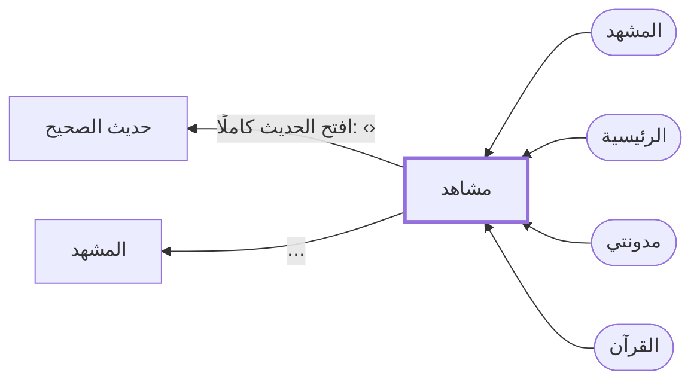

# مشاهد

`mobile/src/app/(tabs)/(quran)/lataif.tsx` · [the whole map](../feature-map.md)

## Ways in

- [المشهد](scene.md)
- [الرئيسية](home.md)
- [مدونتي](library.md)
- [القرآن](quran.md)

## What it opens

| Part of the screen | Label | Opens | Code |
| --- | --- | --- | --- |
| `Hadith` | افتح الحديث كاملًا: ‹› | [حديث الصحيح](hadith-sahih.md) | [components/scenes/RahmanPage.tsx:143](../../mobile/src/components/scenes/RahmanPage.tsx#L143) |
| `LataifScreen` | (onPress) | [المشهد](scene.md) | [screens/lataif.tsx:31](../../mobile/src/screens/lataif.tsx#L31) |
|  | (onPress) | [المشهد](scene.md) | [screens/lataif.tsx:34](../../mobile/src/screens/lataif.tsx#L34) |

## Sheets

None of its own.
