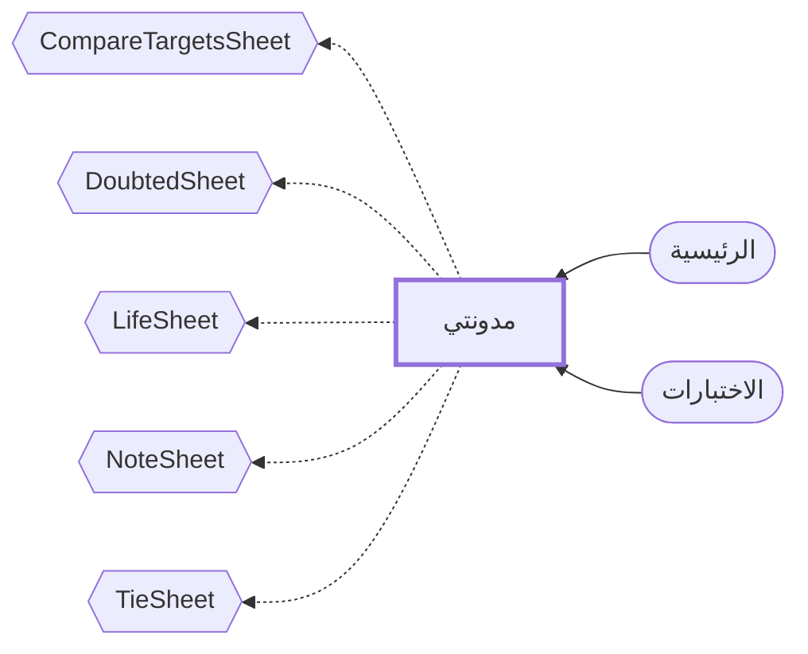

# مدونتي

`mobile/src/app/(tabs)/(home)/library.tsx` · [the whole map](../feature-map.md)

## Ways in

- [الرئيسية](home.md)
- [الاختبارات](quizzes.md)

## What it opens

| Part of the screen | Label | Opens | Code |
| --- | --- | --- | --- |
| `DarkSeaActions` | افتح مشهد ‹› | [المشهد](scene.md) | [components/DarkSea.tsx:256](../../mobile/src/components/DarkSea.tsx#L256) |
|  | افتح ‹› في المصحف | [المصحف](read.md) | [components/DarkSea.tsx:257](../../mobile/src/components/DarkSea.tsx#L257) |
| `EventPlaces` | افتح ‹› في المصحف | [المصحف](read.md) | [components/EventPlaces.tsx:101](../../mobile/src/components/EventPlaces.tsx#L101) |
|  | (onPick) | [مقارنة السور](compare.md) | [components/EventPlaces.tsx:117](../../mobile/src/components/EventPlaces.tsx#L117) |
| `CompareButton` | قارن ‹› | [مقارنة السور](compare.md) | [components/EventPlaces.tsx:129](../../mobile/src/components/EventPlaces.tsx#L129) |
| `useHomeCards` | (onPress) | [المصحف](read.md) | [components/HomeCards.tsx:95](../../mobile/src/components/HomeCards.tsx#L95) |
|  | (onPress) | [متشابهات القرآن](branches.md) | [components/HomeCards.tsx:95](../../mobile/src/components/HomeCards.tsx#L95) |
|  | (onPress) | [مقارنة السور](compare.md) | [components/HomeCards.tsx:95](../../mobile/src/components/HomeCards.tsx#L95) |
|  | افتح صفحة الآية | [صفحة الآية](ayah.md) | [components/HomeCards.tsx:117](../../mobile/src/components/HomeCards.tsx#L117) |
|  | افتح المقارنة | [متشابهات القرآن](branches.md) | [components/HomeCards.tsx:120](../../mobile/src/components/HomeCards.tsx#L120) |
|  | افتح المقارنة | [مقارنة السور](compare.md) | [components/HomeCards.tsx:120](../../mobile/src/components/HomeCards.tsx#L120) |
|  | افتح المقارنة | [المصحف](read.md) | [components/HomeCards.tsx:120](../../mobile/src/components/HomeCards.tsx#L120) |
|  | افتح صفحة الآية | [صفحة الآية](ayah.md) | [components/HomeCards.tsx:124](../../mobile/src/components/HomeCards.tsx#L124) |
|  | (onPick) | [المصحف](read.md) | [components/HomeCards.tsx:127](../../mobile/src/components/HomeCards.tsx#L127) |
|  | (onPick) | [متشابهات القرآن](branches.md) | [components/HomeCards.tsx:127](../../mobile/src/components/HomeCards.tsx#L127) |
|  | (onPick) | [مقارنة السور](compare.md) | [components/HomeCards.tsx:127](../../mobile/src/components/HomeCards.tsx#L127) |
| `ForgottenPost` | افتح صفحة الآية | [صفحة الآية](ayah.md) | [components/HomeFeed.tsx:427](../../mobile/src/components/HomeFeed.tsx#L427) |
|  | افتح ما نسيته | [مدونتي](library.md) | [components/HomeFeed.tsx:429](../../mobile/src/components/HomeFeed.tsx#L429) |
|  | (head) | [الاختبارات](quizzes.md) | [components/HomeFeed.tsx:429](../../mobile/src/components/HomeFeed.tsx#L429) |
| `TarajimPost` | (open) | [الترجمة](person.md) | [components/HomeFeed.tsx:629](../../mobile/src/components/HomeFeed.tsx#L629) |
|  | من التراجم | [التراجم](tarajim.md) | [components/HomeFeed.tsx:631](../../mobile/src/components/HomeFeed.tsx#L631) |
| `TiePost` | (open) | [بين عدة أشخاص](between.md) | [components/HomeFeed.tsx:653](../../mobile/src/components/HomeFeed.tsx#L653) |
|  | صلة | [التراجم](tarajim.md) | [components/HomeFeed.tsx:655](../../mobile/src/components/HomeFeed.tsx#L655) |
| `NamePost` | (open) | [الترجمة](person.md) | [components/HomeFeed.tsx:679](../../mobile/src/components/HomeFeed.tsx#L679) |
|  | كنية وصاحبها | [التراجم](tarajim.md) | [components/HomeFeed.tsx:682](../../mobile/src/components/HomeFeed.tsx#L682) |
| `LifePost` | (open) | [الترجمة](person.md) | [components/HomeFeed.tsx:703](../../mobile/src/components/HomeFeed.tsx#L703) |
|  | من حياته | [الترجمة](person.md) | [components/HomeFeed.tsx:705](../../mobile/src/components/HomeFeed.tsx#L705) |
| `NasabPost` | (open) | [النسب](nasab.md) | [components/HomeFeed.tsx:725](../../mobile/src/components/HomeFeed.tsx#L725) |
|  | (open) | [الترجمة](person.md) | [components/HomeFeed.tsx:727](../../mobile/src/components/HomeFeed.tsx#L727) |
| `TiesPost` | (open) | [الصلات](ties.md) | [components/HomeFeed.tsx:742](../../mobile/src/components/HomeFeed.tsx#L742) |
|  | (open) | [الترجمة](person.md) | [components/HomeFeed.tsx:744](../../mobile/src/components/HomeFeed.tsx#L744) |
|  | (onPick) | [الترجمة](person.md) | [components/HomeFeed.tsx:748](../../mobile/src/components/HomeFeed.tsx#L748) |
| `GroupPost` | (open) | [بين عدة أشخاص](between.md) | [components/HomeFeed.tsx:772](../../mobile/src/components/HomeFeed.tsx#L772) |
|  | (open) | [التراجم](tarajim.md) | [components/HomeFeed.tsx:774](../../mobile/src/components/HomeFeed.tsx#L774) |
| `LivesPost` | (open) | [حياتهم جنبًا إلى جنب](life.md) | [components/HomeFeed.tsx:793](../../mobile/src/components/HomeFeed.tsx#L793) |
|  | حياتهما | [التراجم](tarajim.md) | [components/HomeFeed.tsx:795](../../mobile/src/components/HomeFeed.tsx#L795) |
| `MeetPost` | (open) | [النسب](nasab.md) | [components/HomeFeed.tsx:815](../../mobile/src/components/HomeFeed.tsx#L815) |
|  | أين يلتقي نسبهما؟ | [التراجم](tarajim.md) | [components/HomeFeed.tsx:818](../../mobile/src/components/HomeFeed.tsx#L818) |
| `RingPost` | (go) | [الترجمة](person.md) | [components/HomeFeed.tsx:844](../../mobile/src/components/HomeFeed.tsx#L844) |
|  | (open) | [الترجمة](person.md) | [components/HomeFeed.tsx:860](../../mobile/src/components/HomeFeed.tsx#L860) |
|  | (open) | [كتاب الحديث](hadith-book.md) | [components/HomeFeed.tsx:861](../../mobile/src/components/HomeFeed.tsx#L861) |
|  | (open) | [التراجم](tarajim.md) | [components/HomeFeed.tsx:861](../../mobile/src/components/HomeFeed.tsx#L861) |
|  | (open) | [الصلات](ties.md) | [components/HomeFeed.tsx:862](../../mobile/src/components/HomeFeed.tsx#L862) |
|  | (open) | [كل التراجم](people.md) | [components/HomeFeed.tsx:863](../../mobile/src/components/HomeFeed.tsx#L863) |
|  | (open) | [حديث الصحيح](hadith-sahih.md) | [components/HomeFeed.tsx:864](../../mobile/src/components/HomeFeed.tsx#L864) |
| `BattlePost` | (open) | [الغزوة](battle.md) | [components/HomeFeed.tsx:892](../../mobile/src/components/HomeFeed.tsx#L892) |
|  | (open) | [الغزوات والمعارك](battles.md) | [components/HomeFeed.tsx:894](../../mobile/src/components/HomeFeed.tsx#L894) |
| `BattleYearPost` | (toYear) | [الأطلس](atlas.md) | [components/HomeFeed.tsx:917](../../mobile/src/components/HomeFeed.tsx#L917) |
|  | من الأطلس | [الأطلس](atlas.md) | [components/HomeFeed.tsx:922](../../mobile/src/components/HomeFeed.tsx#L922) |
|  | افتح ‹› | [الغزوة](battle.md) | [components/HomeFeed.tsx:932](../../mobile/src/components/HomeFeed.tsx#L932) |
| `ArmiesPost` | الجيشان في الغزوات | [الغزوات والمعارك](battles.md) | [components/HomeFeed.tsx:955](../../mobile/src/components/HomeFeed.tsx#L955) |
|  | افتح الغزوات والمعارك | [الغزوات والمعارك](battles.md) | [components/HomeFeed.tsx:956](../../mobile/src/components/HomeFeed.tsx#L956) |
|  | افتح ‹› | [الغزوة](battle.md) | [components/HomeFeed.tsx:965](../../mobile/src/components/HomeFeed.tsx#L965) |
| `HadithScenePost` | (open) | [رواية الصحيح](hadith-unit.md) | [components/HomeFeed.tsx:982](../../mobile/src/components/HomeFeed.tsx#L982) |
|  | من ‹› | [الحديث](hadith.md) | [components/HomeFeed.tsx:984](../../mobile/src/components/HomeFeed.tsx#L984) |
| `OpeningCardPost` | (open) | [فواتح السور](openings.md) | [components/HomeFeed.tsx:1005](../../mobile/src/components/HomeFeed.tsx#L1005) |
|  | من فواتح السور | [فواتح السور](openings.md) | [components/HomeFeed.tsx:1007](../../mobile/src/components/HomeFeed.tsx#L1007) |
| `OathPost` | (open) | [الأقسام](oaths.md) | [components/HomeFeed.tsx:1023](../../mobile/src/components/HomeFeed.tsx#L1023) |
|  | من الأقسام | [الأقسام](oaths.md) | [components/HomeFeed.tsx:1025](../../mobile/src/components/HomeFeed.tsx#L1025) |
|  | افتح ‹› في المصحف | [المصحف](read.md) | [components/HomeFeed.tsx:1027](../../mobile/src/components/HomeFeed.tsx#L1027) |
| `SurahAimPost` | مقصود السورة | [ترتيب السور](order.md) | [components/HomeFeed.tsx:1046](../../mobile/src/components/HomeFeed.tsx#L1046) |
|  | افتح سورة ‹› في ترتيب السور | [ترتيب السور](order.md) | [components/HomeFeed.tsx:1047](../../mobile/src/components/HomeFeed.tsx#L1047) |
| `SurahLinkPost` | بين سورتين | [ترتيب السور](order.md) | [components/HomeFeed.tsx:1063](../../mobile/src/components/HomeFeed.tsx#L1063) |
|  | افتح ‹› و‹› في ترتيب السور | [ترتيب السور](order.md) | [components/HomeFeed.tsx:1064](../../mobile/src/components/HomeFeed.tsx#L1064) |
| `EventPost` | (open) | [قصة النبي](prophets-slug.md) | [components/HomeFeed.tsx:1084](../../mobile/src/components/HomeFeed.tsx#L1084) |
|  | (open) | [قصص الأنبياء](prophets.md) | [components/HomeFeed.tsx:1086](../../mobile/src/components/HomeFeed.tsx#L1086) |
| `StoryPost` | (open) | [قصة النبي](prophets-slug.md) | [components/HomeFeed.tsx:1192](../../mobile/src/components/HomeFeed.tsx#L1192) |
|  | (open) | [قصص الأنبياء](prophets.md) | [components/HomeFeed.tsx:1194](../../mobile/src/components/HomeFeed.tsx#L1194) |
| `ScenePost` | افتح المشاهد | [مشاهد](lataif.md) | [components/HomeFeed.tsx:1344](../../mobile/src/components/HomeFeed.tsx#L1344) |
|  | (onPress) | [المشهد](scene.md) | [components/HomeFeed.tsx:1347](../../mobile/src/components/HomeFeed.tsx#L1347) |
|  | افتح المشاهد | [مشاهد](lataif.md) | [components/HomeFeed.tsx:1352](../../mobile/src/components/HomeFeed.tsx#L1352) |
|  | (onPress) | [المشهد](scene.md) | [components/HomeFeed.tsx:1355](../../mobile/src/components/HomeFeed.tsx#L1355) |
| `SiraPost` | (open) | [القصة](story.md) | [components/HomeFeed.tsx:1370](../../mobile/src/components/HomeFeed.tsx#L1370) |
|  | من قصص السيرة | [قصص السيرة](stories.md) | [components/HomeFeed.tsx:1372](../../mobile/src/components/HomeFeed.tsx#L1372) |
| `RajabPost` | (open) | [حديث الأربعين](hadith-forty.md) | [components/HomeFeed.tsx:1403](../../mobile/src/components/HomeFeed.tsx#L1403) |
|  | من شرح ابن رجب | [كتاب الحديث](hadith-book.md) | [components/HomeFeed.tsx:1405](../../mobile/src/components/HomeFeed.tsx#L1405) |
| `HadithPost` | (open) | [حديث الأربعين](hadith-forty.md) | [components/HomeFeed.tsx:1420](../../mobile/src/components/HomeFeed.tsx#L1420) |
|  | من الحديث | [كتاب الحديث](hadith-book.md) | [components/HomeFeed.tsx:1422](../../mobile/src/components/HomeFeed.tsx#L1422) |
| `SahihPost` | (open) | [حديث الصحيح](hadith-sahih.md) | [components/HomeFeed.tsx:1446](../../mobile/src/components/HomeFeed.tsx#L1446) |
|  | من ‹› | [كتاب الحديث](hadith-book.md) | [components/HomeFeed.tsx:1449](../../mobile/src/components/HomeFeed.tsx#L1449) |
| `RecordedPost` | (open) | [حديث الأربعين](hadith-forty.md) | [components/HomeFeed.tsx:1466](../../mobile/src/components/HomeFeed.tsx#L1466) |
|  | من أخرجه | [كتاب الحديث](hadith-book.md) | [components/HomeFeed.tsx:1468](../../mobile/src/components/HomeFeed.tsx#L1468) |
| `IsnadPost` | (open) | [حديث الأربعين](hadith-forty.md) | [components/HomeFeed.tsx:1490](../../mobile/src/components/HomeFeed.tsx#L1490) |
|  | من الإسناد | [كتاب الحديث](hadith-book.md) | [components/HomeFeed.tsx:1492](../../mobile/src/components/HomeFeed.tsx#L1492) |
| `TermPost` | (open) | [المصطلح](term.md) | [components/HomeFeed.tsx:1517](../../mobile/src/components/HomeFeed.tsx#L1517) |
|  | من مصطلحات البلاغة | [مصطلحات البلاغة](terms.md) | [components/HomeFeed.tsx:1519](../../mobile/src/components/HomeFeed.tsx#L1519) |
|  | مصطلحات البلاغة | [مصطلحات البلاغة](terms.md) | [components/HomeFeed.tsx:1521](../../mobile/src/components/HomeFeed.tsx#L1521) |
| `GharibPost` | (open) | [الكلمة](word.md) | [components/HomeFeed.tsx:1559](../../mobile/src/components/HomeFeed.tsx#L1559) |
|  | (open) | [صفحة الآية](ayah.md) | [components/HomeFeed.tsx:1559](../../mobile/src/components/HomeFeed.tsx#L1559) |
|  | من غريب القرآن | [ألفاظ القرآن](words.md) | [components/HomeFeed.tsx:1561](../../mobile/src/components/HomeFeed.tsx#L1561) |
| `TuhfaPost` | من تحفة الأطفال | [تحفة الأطفال](tuhfa.md) | [components/HomeFeed.tsx:1582](../../mobile/src/components/HomeFeed.tsx#L1582) |
|  | افتح المنظومة | [تحفة الأطفال](tuhfa.md) | [components/HomeFeed.tsx:1583](../../mobile/src/components/HomeFeed.tsx#L1583) |
| `MomentPost` | (open) | [الغزوة](battle.md) | [components/HomeFeed.tsx:1604](../../mobile/src/components/HomeFeed.tsx#L1604) |
|  | من ‹› | [الغزوة](battle.md) | [components/HomeFeed.tsx:1606](../../mobile/src/components/HomeFeed.tsx#L1606) |
| `NOTE_TOPICS` | (tafsir) | [الكتاب](book.md) | [components/HomeFeed.tsx:1648](../../mobile/src/components/HomeFeed.tsx#L1648) |
|  | (balagha) | [مصطلحات البلاغة](terms.md) | [components/HomeFeed.tsx:1649](../../mobile/src/components/HomeFeed.tsx#L1649) |
|  | (irab) | [المكتبة](books.md) | [components/HomeFeed.tsx:1650](../../mobile/src/components/HomeFeed.tsx#L1650) |
|  | (qiraat) | [القراءات](qiraat.md) | [components/HomeFeed.tsx:1651](../../mobile/src/components/HomeFeed.tsx#L1651) |
| `AyahNotePost` | (show) | [صفحة الآية](ayah.md) | [components/HomeFeed.tsx:1673](../../mobile/src/components/HomeFeed.tsx#L1673) |
| `DhikrPost` | افتح الأذكار | [الأدوات والأذكار](utilities.md) | [components/HomeFeed.tsx:1720](../../mobile/src/components/HomeFeed.tsx#L1720) |
|  | افتح الذكر في الأذكار | [الذكر](dhikr.md) | [components/HomeFeed.tsx:1721](../../mobile/src/components/HomeFeed.tsx#L1721) |
| `Cell` | (onPress) | [الغزوة](battle.md) | [components/LifeColumns.tsx:18](../../mobile/src/components/LifeColumns.tsx#L18) |
|  | (onPress) | [القصة](story.md) | [components/LifeColumns.tsx:18](../../mobile/src/components/LifeColumns.tsx#L18) |
| `Item` | (onPress) | [الغزوة](battle.md) | [components/LifeTimeline.tsx:123](../../mobile/src/components/LifeTimeline.tsx#L123) |
|  | (onPress) | [القصة](story.md) | [components/LifeTimeline.tsx:123](../../mobile/src/components/LifeTimeline.tsx#L123) |
| `LifeSheet` | (onPress) | [الغزوة](battle.md) | [components/LifeTimeline.tsx:164](../../mobile/src/components/LifeTimeline.tsx#L164) |
|  | (onPress) | [القصة](story.md) | [components/LifeTimeline.tsx:164](../../mobile/src/components/LifeTimeline.tsx#L164) |
| `RahmanActions` | افتح مشهد ‹› | [المشهد](scene.md) | [components/RahmanScene.tsx:208](../../mobile/src/components/RahmanScene.tsx#L208) |
| `TiesChain` | (open) | [الصلات](ties.md) | [components/TiesChain.tsx:164](../../mobile/src/components/TiesChain.tsx#L164) |
| `People` | (onPress) | [الترجمة](person.md) | [components/battles/BattleParts.tsx:130](../../mobile/src/components/battles/BattleParts.tsx#L130) |
| `Hadith` | افتح الحديث كاملًا: ‹› | [حديث الصحيح](hadith-sahih.md) | [components/scenes/RahmanPage.tsx:143](../../mobile/src/components/scenes/RahmanPage.tsx#L143) |
| `LibraryScreen` | ({ cards, noteCards, savedItems, noteItems, openOf, openAyah, menus }) | [المصحف](read.md) | [screens/library.tsx:95](../../mobile/src/screens/library.tsx#L95) |
|  | ({ cards, noteCards, savedItems, noteItems, openOf, openAyah, menus }) | [متشابهات القرآن](branches.md) | [screens/library.tsx:95](../../mobile/src/screens/library.tsx#L95) |
|  | ({ cards, noteCards, savedItems, noteItems, openOf, openAyah, menus }) | [مقارنة السور](compare.md) | [screens/library.tsx:95](../../mobile/src/screens/library.tsx#L95) |
|  | ({ cards, noteCards, savedItems, noteItems, openOf, openAyah, menus }) | [صفحة الآية](ayah.md) | [screens/library.tsx:95](../../mobile/src/screens/library.tsx#L95) |
|  | افتح الآية في المصحف | [المصحف](read.md) | [screens/library.tsx:138](../../mobile/src/screens/library.tsx#L138) |
|  | (back) | [الرئيسية](home.md) | [screens/library.tsx:151](../../mobile/src/screens/library.tsx#L151) |
| `Box` | (onPress) | [الترجمة](person.md) | [screens/nasab.tsx:33](../../mobile/src/screens/nasab.tsx#L33) |
| `OpeningRows` | افتح ‹› في المصحف | [المصحف](read.md) | [screens/openings.tsx:74](../../mobile/src/screens/openings.tsx#L74) |

## Sheets

- `CompareTargetsSheet`
- `DoubtedSheet`
- `LifeSheet`
- `NoteSheet`
- `TieSheet`
