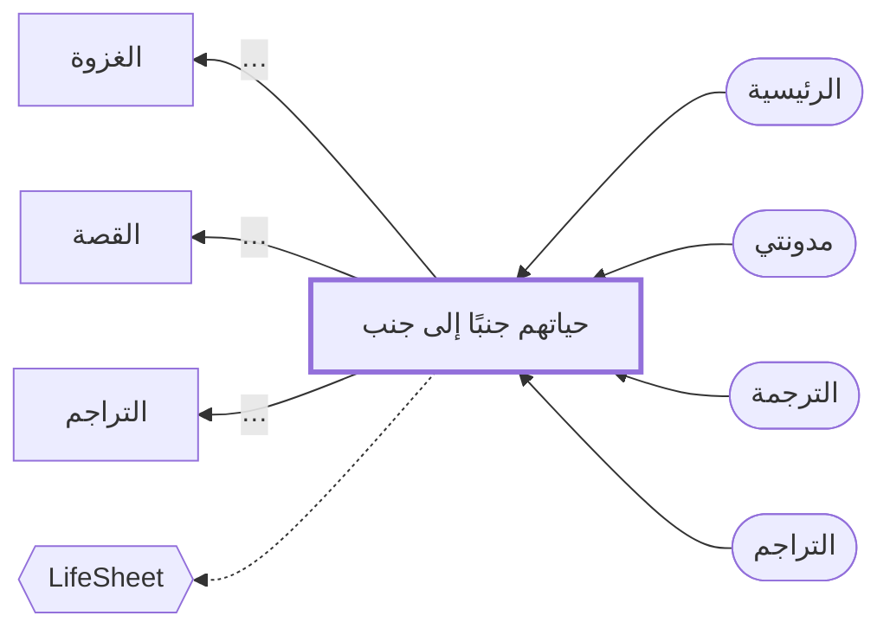

# حياتهم جنبًا إلى جنب

`mobile/src/app/(tabs)/(tarajim)/life.tsx` · [the whole map](../feature-map.md)

## Ways in

- [الرئيسية](home.md)
- [مدونتي](library.md)
- [الترجمة](person.md)
- [التراجم](tarajim.md)

## What it opens

| Part of the screen | Label | Opens | Code |
| --- | --- | --- | --- |
| `Cell` | (onPress) | [الغزوة](battle.md) | [components/LifeColumns.tsx:18](../../mobile/src/components/LifeColumns.tsx#L18) |
|  | (onPress) | [القصة](story.md) | [components/LifeColumns.tsx:18](../../mobile/src/components/LifeColumns.tsx#L18) |
| `LifeSheet` | (onPress) | [الغزوة](battle.md) | [components/LifeTimeline.tsx:164](../../mobile/src/components/LifeTimeline.tsx#L164) |
|  | (onPress) | [القصة](story.md) | [components/LifeTimeline.tsx:164](../../mobile/src/components/LifeTimeline.tsx#L164) |
| `LifeScreen` | (back) | [التراجم](tarajim.md) | [screens/life.tsx:37](../../mobile/src/screens/life.tsx#L37) |

## Sheets

- `LifeSheet`
