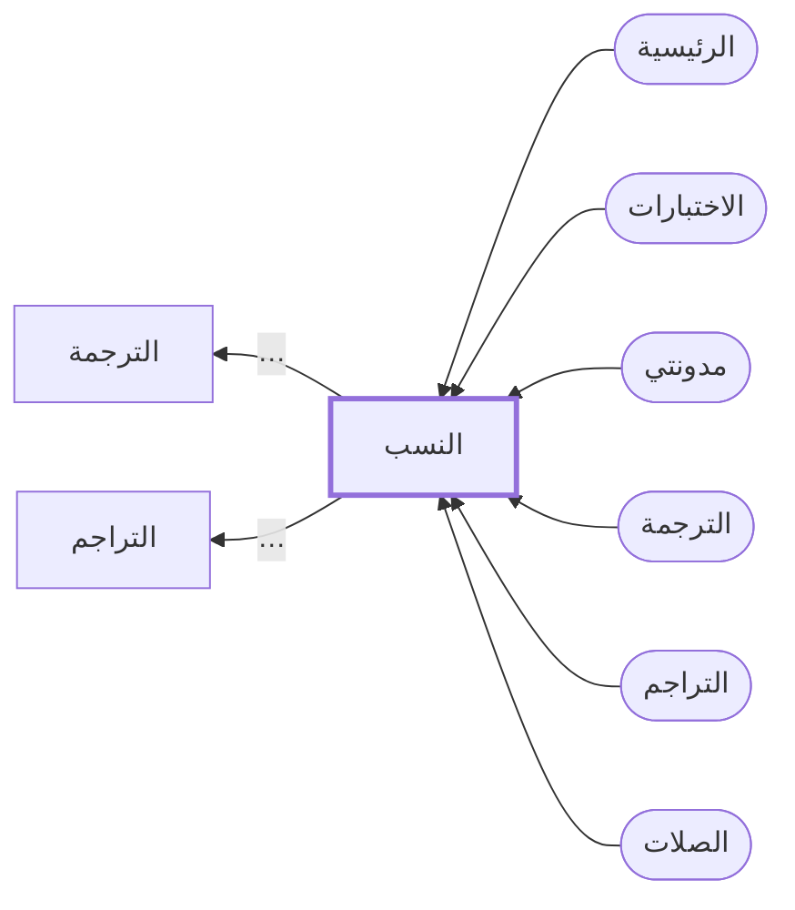

# النسب

`mobile/src/app/(tabs)/(tarajim)/nasab.tsx` · [the whole map](../feature-map.md)

## Ways in

- [الرئيسية](home.md)
- [الاختبارات](quizzes.md)
- [مدونتي](library.md)
- [الترجمة](person.md)
- [التراجم](tarajim.md)
- [الصلات](ties.md)

## What it opens

| Part of the screen | Label | Opens | Code |
| --- | --- | --- | --- |
| `Box` | (onPress) | [الترجمة](person.md) | [screens/nasab.tsx:33](../../mobile/src/screens/nasab.tsx#L33) |
| `NasabScreen` | (back) | [التراجم](tarajim.md) | [screens/nasab.tsx:205](../../mobile/src/screens/nasab.tsx#L205) |

## Sheets

None of its own.
