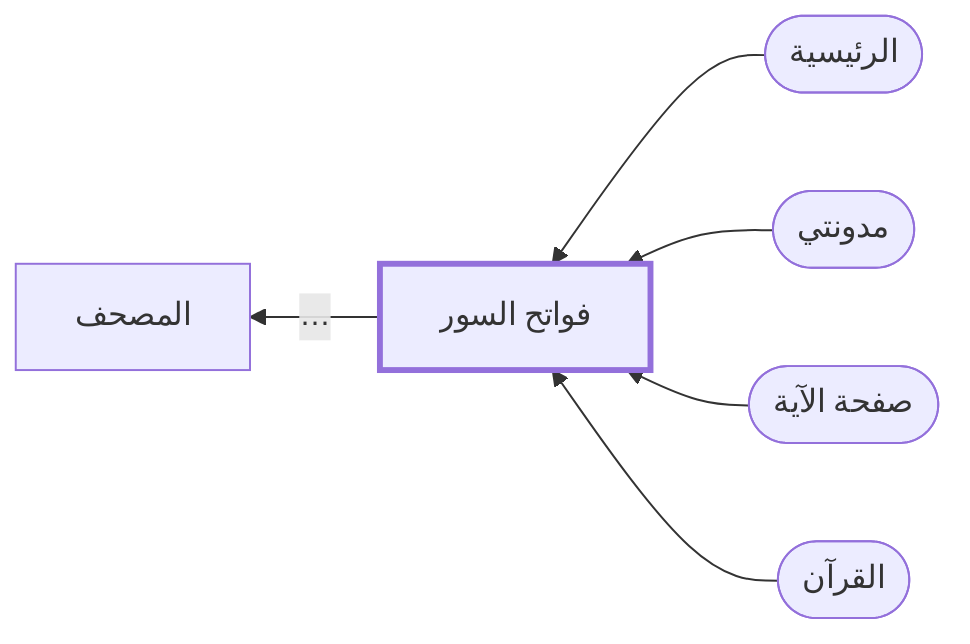

# فواتح السور

`mobile/src/app/(tabs)/(quran)/openings.tsx` · [the whole map](../feature-map.md)

## Ways in

- [الرئيسية](home.md)
- [مدونتي](library.md)
- [صفحة الآية](ayah.md)
- [القرآن](quran.md)

## What it opens

| Part of the screen | Label | Opens | Code |
| --- | --- | --- | --- |
| `OpeningRows` | ‹›:1 | [المصحف](read.md) | [screens/openings.tsx:70](../../mobile/src/screens/openings.tsx#L70) |

## Sheets

None of its own.
