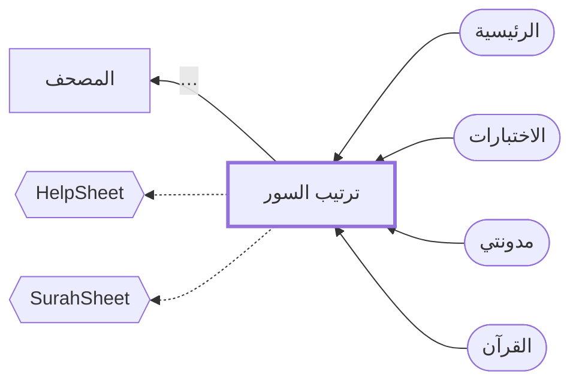

# ترتيب السور

`mobile/src/app/(tabs)/(quran)/order.tsx` · [the whole map](../feature-map.md)

## Ways in

- [الرئيسية](home.md)
- [الاختبارات](quizzes.md)
- [مدونتي](library.md)
- [القرآن](quran.md)

## What it opens

| Part of the screen | Label | Opens | Code |
| --- | --- | --- | --- |
| `SurahCard` | ‹›:1 | [المصحف](read.md) | [components/OrderSurah.tsx:105](../../mobile/src/components/OrderSurah.tsx#L105) |

## Sheets

- `HelpSheet`
- `SurahSheet`
