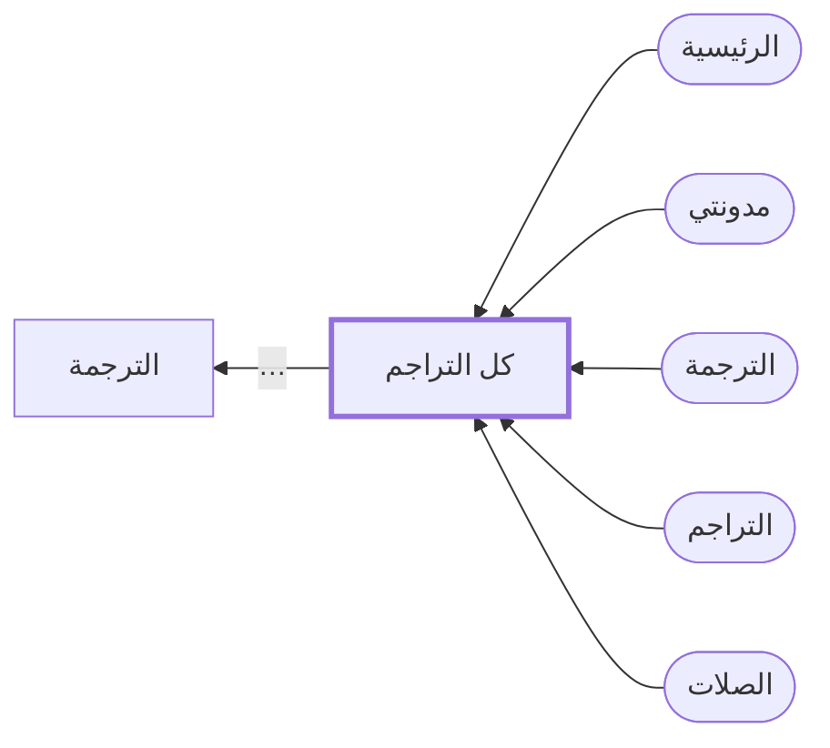

# كل التراجم

`mobile/src/app/(tabs)/(tarajim)/people.tsx` · [the whole map](../feature-map.md)

## Ways in

- [الرئيسية](home.md)
- [مدونتي](library.md)
- [الترجمة](person.md)
- [التراجم](tarajim.md)
- [الصلات](ties.md)

## What it opens

| Part of the screen | Label | Opens | Code |
| --- | --- | --- | --- |
| `PersonRows` | (onPress) | [الترجمة](person.md) | [components/tarajim/PersonRows.tsx:16](../../mobile/src/components/tarajim/PersonRows.tsx#L16) |

## Sheets

None of its own.
