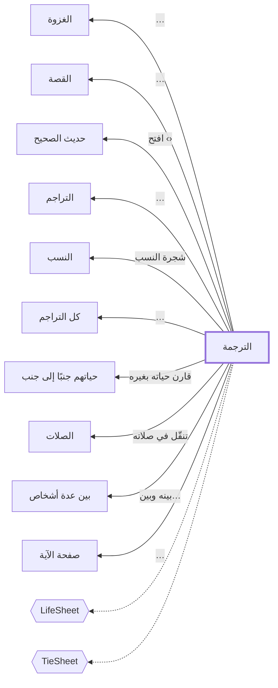

# الترجمة

`mobile/src/app/(tabs)/(tarajim)/person.tsx` · [the whole map](../feature-map.md)

## Ways in

- [الرئيسية](home.md)
- [الاختبارات](quizzes.md)
- [مدونتي](library.md)
- [البحث](search.md)
- [القرآن](quran.md)
- [حديث الصحيح](hadith-sahih.md)
- [الغزوة](battle.md)
- [القصة](story.md)
- [صفحة الآية](ayah.md)
- [غرفة الاختبار الجماعي](quiz-party-code.md)
- [الاختبار](quiz-play.md)
- [كل التراجم](people.md)
- [التراجم](tarajim.md)
- [النسب](nasab.md)
- [الصلات](ties.md)

## What it opens

| Part of the screen | Label | Opens | Code |
| --- | --- | --- | --- |
| `Item` | (onPress) | [الغزوة](battle.md) | [components/LifeTimeline.tsx:106](../../mobile/src/components/LifeTimeline.tsx#L106) |
|  | (onPress) | [القصة](story.md) | [components/LifeTimeline.tsx:106](../../mobile/src/components/LifeTimeline.tsx#L106) |
| `LifeSheet` | (onPress) | [الغزوة](battle.md) | [components/LifeTimeline.tsx:145](../../mobile/src/components/LifeTimeline.tsx#L145) |
|  | (onPress) | [القصة](story.md) | [components/LifeTimeline.tsx:145](../../mobile/src/components/LifeTimeline.tsx#L145) |
| `SahihSaying` | افتح ‹› | [حديث الصحيح](hadith-sahih.md) | [components/SahihSaying.tsx:43](../../mobile/src/components/SahihSaying.tsx#L43) |
| `StoryLinkRow` | (onPress) | [القصة](story.md) | [components/stories/StoryParts.tsx:131](../../mobile/src/components/stories/StoryParts.tsx#L131) |
| `Names` | (onPress) | [الترجمة](person.md) | [screens/person.tsx:210](../../mobile/src/screens/person.tsx#L210) |
| `PersonScreen` | (showBattle) | [الغزوة](battle.md) | [screens/person.tsx:247](../../mobile/src/screens/person.tsx#L247) |
|  | (back) | [التراجم](tarajim.md) | [screens/person.tsx:252](../../mobile/src/screens/person.tsx#L252) |
|  | شجرة النسب | [النسب](nasab.md) | [screens/person.tsx:254](../../mobile/src/screens/person.tsx#L254) |
|  | (onPress) | [كل التراجم](people.md) | [screens/person.tsx:294](../../mobile/src/screens/person.tsx#L294) |
|  | قارن حياته بغيره | [حياتهم جنبًا إلى جنب](life.md) | [screens/person.tsx:316](../../mobile/src/screens/person.tsx#L316) |
|  | (onPin) | [الغزوة](battle.md) | [screens/person.tsx:327](../../mobile/src/screens/person.tsx#L327) |
|  | (onPress) | [الغزوة](battle.md) | [screens/person.tsx:329](../../mobile/src/screens/person.tsx#L329) |
|  | تنقّل في صلاته | [الصلات](ties.md) | [screens/person.tsx:338](../../mobile/src/screens/person.tsx#L338) |
|  | بينه وبين… | [بين عدة أشخاص](between.md) | [screens/person.tsx:339](../../mobile/src/screens/person.tsx#L339) |
|  | (onPick) | [الترجمة](person.md) | [screens/person.tsx:342](../../mobile/src/screens/person.tsx#L342) |
|  | ‹›‹› | [صفحة الآية](ayah.md) | [screens/person.tsx:361](../../mobile/src/screens/person.tsx#L361) |
|  | (onPress) | [صفحة الآية](ayah.md) | [screens/person.tsx:370](../../mobile/src/screens/person.tsx#L370) |

## Sheets

- `LifeSheet`
- `TieSheet`
