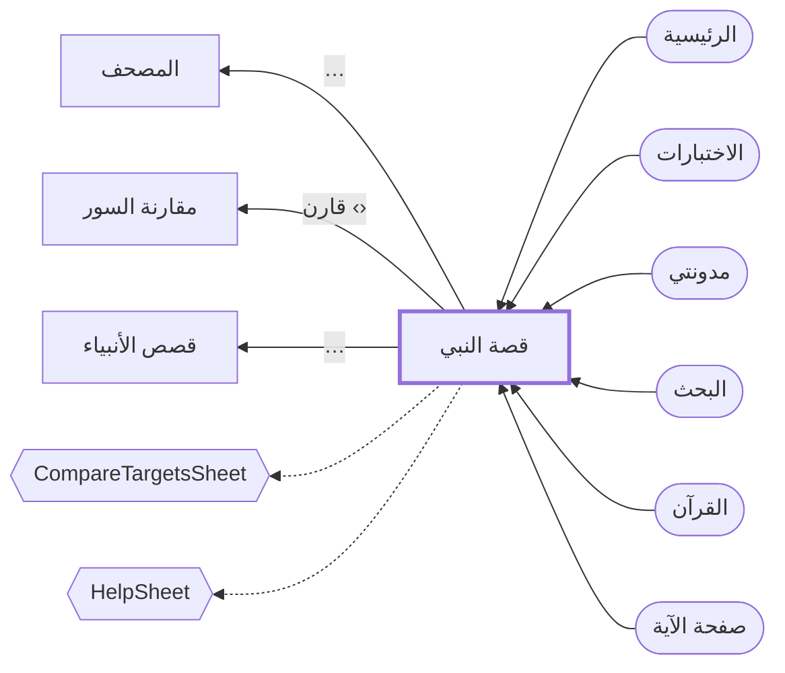

# قصة النبي

`mobile/src/app/prophets/[slug].tsx` · [the whole map](../feature-map.md)

## Ways in

- [الرئيسية](home.md)
- [الاختبارات](quizzes.md)
- [مدونتي](library.md)
- [البحث](search.md)
- [القرآن](quran.md)
- [صفحة الآية](ayah.md)

## What it opens

| Part of the screen | Label | Opens | Code |
| --- | --- | --- | --- |
| `EventPlaces` | ‹›:‹› | [المصحف](read.md) | [components/EventPlaces.tsx:92](../../mobile/src/components/EventPlaces.tsx#L92) |
|  | (onPick) | [مقارنة السور](compare.md) | [components/EventPlaces.tsx:106](../../mobile/src/components/EventPlaces.tsx#L106) |
| `CompareButton` | قارن ‹› | [مقارنة السور](compare.md) | [components/EventPlaces.tsx:116](../../mobile/src/components/EventPlaces.tsx#L116) |
| `ProphetScreen` | (back) | [قصص الأنبياء](prophets.md) | [screens/prophets/slug.tsx:8](../../mobile/src/screens/prophets/slug.tsx#L8) |

## Sheets

- `CompareTargetsSheet`
- `HelpSheet`
