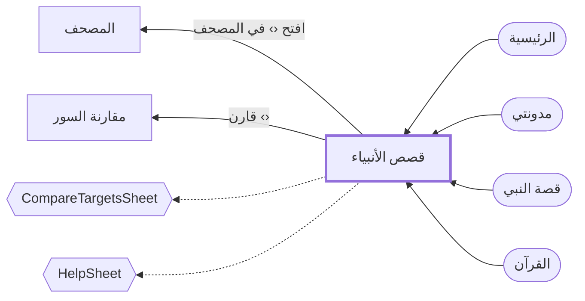

# قصص الأنبياء

`mobile/src/app/(tabs)/(quran)/prophets.tsx` · [the whole map](../feature-map.md)

## Ways in

- [الرئيسية](home.md)
- [مدونتي](library.md)
- [قصة النبي](prophets-slug.md)
- [القرآن](quran.md)

## What it opens

| Part of the screen | Label | Opens | Code |
| --- | --- | --- | --- |
| `EventPlaces` | افتح ‹› في المصحف | [المصحف](read.md) | [components/EventPlaces.tsx:101](../../mobile/src/components/EventPlaces.tsx#L101) |
|  | (onPick) | [مقارنة السور](compare.md) | [components/EventPlaces.tsx:117](../../mobile/src/components/EventPlaces.tsx#L117) |
| `CompareButton` | قارن ‹› | [مقارنة السور](compare.md) | [components/EventPlaces.tsx:129](../../mobile/src/components/EventPlaces.tsx#L129) |

## Sheets

- `CompareTargetsSheet`
- `HelpSheet`
