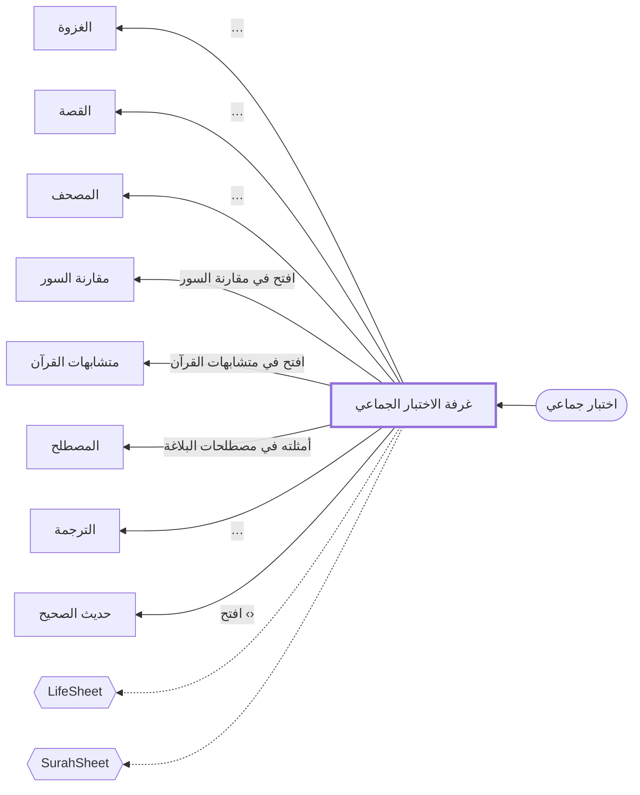

# غرفة الاختبار الجماعي

`mobile/src/app/quiz/party/[code].tsx` · [the whole map](../feature-map.md)

## Ways in

- [اختبار جماعي](quiz-party.md)

## What it opens

| Part of the screen | Label | Opens | Code |
| --- | --- | --- | --- |
| `Item` | (onPress) | [الغزوة](battle.md) | [components/LifeTimeline.tsx:107](../../mobile/src/components/LifeTimeline.tsx#L107) |
|  | (onPress) | [القصة](story.md) | [components/LifeTimeline.tsx:107](../../mobile/src/components/LifeTimeline.tsx#L107) |
| `LifeSheet` | (onPress) | [الغزوة](battle.md) | [components/LifeTimeline.tsx:146](../../mobile/src/components/LifeTimeline.tsx#L146) |
|  | (onPress) | [القصة](story.md) | [components/LifeTimeline.tsx:146](../../mobile/src/components/LifeTimeline.tsx#L146) |
| `SurahCard` | ‹›:1 | [المصحف](read.md) | [components/OrderSurah.tsx:95](../../mobile/src/components/OrderSurah.tsx#L95) |
| `CompareFeedback` | افتح في مقارنة السور | [مقارنة السور](compare.md) | [components/QuizCompare.tsx:120](../../mobile/src/components/QuizCompare.tsx#L120) |
| `TreeActions` | افتح في متشابهات القرآن | [متشابهات القرآن](branches.md) | [components/QuizTree.tsx:181](../../mobile/src/components/QuizTree.tsx#L181) |
| `TermChips` | أمثلته في مصطلحات البلاغة | [المصطلح](term.md) | [components/TermSheet.tsx:34](../../mobile/src/components/TermSheet.tsx#L34) |
| `People` | (onPress) | [الترجمة](person.md) | [components/battles/BattleParts.tsx:113](../../mobile/src/components/battles/BattleParts.tsx#L113) |
| `Box` | (onPress) | [الترجمة](person.md) | [screens/nasab.tsx:31](../../mobile/src/screens/nasab.tsx#L31) |
| `QuestionStage` | (onOpen) | [المصحف](read.md) | [screens/quiz/party/code.tsx:360](../../mobile/src/screens/quiz/party/code.tsx#L360) |
|  | (onOpen) | [المصحف](read.md) | [screens/quiz/party/code.tsx:400](../../mobile/src/screens/quiz/party/code.tsx#L400) |
| `FinalResults` | (onOpen) | [المصحف](read.md) | [screens/quiz/party/code.tsx:434](../../mobile/src/screens/quiz/party/code.tsx#L434) |
| `HadithOpen` | افتح ‹› | [حديث الصحيح](hadith-sahih.md) | [screens/story.tsx:68](../../mobile/src/screens/story.tsx#L68) |

## Sheets

- `LifeSheet`
- `SurahSheet`
