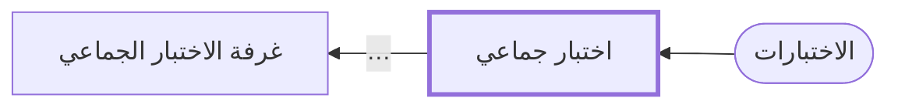

# اختبار جماعي

`mobile/src/app/quiz/party/index.tsx` · [the whole map](../feature-map.md)

## Ways in

- [الاختبارات](quizzes.md)

## What it opens

| Part of the screen | Label | Opens | Code |
| --- | --- | --- | --- |
| `PartyStart` | (start) | [غرفة الاختبار الجماعي](quiz-party-code.md) | [screens/quiz/party/index.tsx:29](../../mobile/src/screens/quiz/party/index.tsx#L29) |
|  | (join) | [غرفة الاختبار الجماعي](quiz-party-code.md) | [screens/quiz/party/index.tsx:38](../../mobile/src/screens/quiz/party/index.tsx#L38) |

## Sheets

None of its own.
