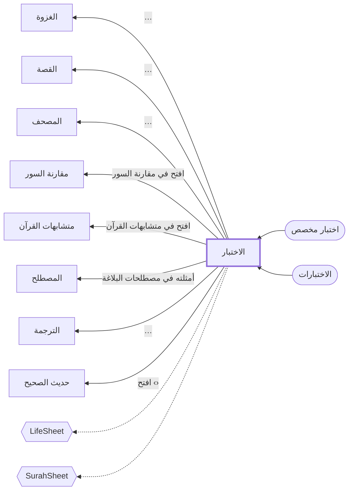

# الاختبار

`mobile/src/app/quiz/play.tsx` · [the whole map](../feature-map.md)

## Ways in

- [اختبار مخصص](quiz-solo.md)
- [الاختبارات](quizzes.md)

## What it opens

| Part of the screen | Label | Opens | Code |
| --- | --- | --- | --- |
| `Item` | (onPress) | [الغزوة](battle.md) | [components/LifeTimeline.tsx:123](../../mobile/src/components/LifeTimeline.tsx#L123) |
|  | (onPress) | [القصة](story.md) | [components/LifeTimeline.tsx:123](../../mobile/src/components/LifeTimeline.tsx#L123) |
| `LifeSheet` | (onPress) | [الغزوة](battle.md) | [components/LifeTimeline.tsx:164](../../mobile/src/components/LifeTimeline.tsx#L164) |
|  | (onPress) | [القصة](story.md) | [components/LifeTimeline.tsx:164](../../mobile/src/components/LifeTimeline.tsx#L164) |
| `SurahCard` | ‹›:1 | [المصحف](read.md) | [components/OrderSurah.tsx:105](../../mobile/src/components/OrderSurah.tsx#L105) |
| `CompareFeedback` | افتح في مقارنة السور | [مقارنة السور](compare.md) | [components/QuizCompare.tsx:135](../../mobile/src/components/QuizCompare.tsx#L135) |
| `TreeActions` | افتح في متشابهات القرآن | [متشابهات القرآن](branches.md) | [components/QuizTree.tsx:204](../../mobile/src/components/QuizTree.tsx#L204) |
| `TermChips` | أمثلته في مصطلحات البلاغة | [المصطلح](term.md) | [components/TermSheet.tsx:39](../../mobile/src/components/TermSheet.tsx#L39) |
| `People` | (onPress) | [الترجمة](person.md) | [components/battles/BattleParts.tsx:130](../../mobile/src/components/battles/BattleParts.tsx#L130) |
| `Box` | (onPress) | [الترجمة](person.md) | [screens/nasab.tsx:33](../../mobile/src/screens/nasab.tsx#L33) |
| `Results` | (onOpen) | [المصحف](read.md) | [screens/quiz/play.tsx:48](../../mobile/src/screens/quiz/play.tsx#L48) |
| `QuizPlay` | (onOpen) | [المصحف](read.md) | [screens/quiz/play.tsx:109](../../mobile/src/screens/quiz/play.tsx#L109) |
| `HadithOpen` | افتح ‹› | [حديث الصحيح](hadith-sahih.md) | [screens/story.tsx:77](../../mobile/src/screens/story.tsx#L77) |

## Sheets

- `LifeSheet`
- `SurahSheet`
