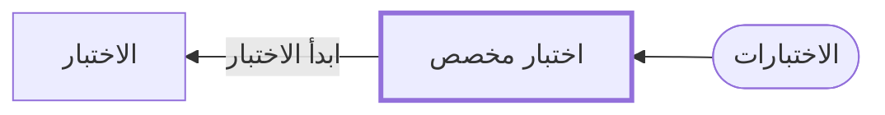

# اختبار مخصص

`mobile/src/app/quiz/solo.tsx` · [the whole map](../feature-map.md)

## Ways in

- [الاختبارات](quizzes.md)

## What it opens

| Part of the screen | Label | Opens | Code |
| --- | --- | --- | --- |
| `SoloSetup` | ابدأ الاختبار | [الاختبار](quiz-play.md) | [screens/quiz/solo.tsx:64](../../mobile/src/screens/quiz/solo.tsx#L64) |
|  | أكمله | [الاختبار](quiz-play.md) | [screens/quiz/solo.tsx:79](../../mobile/src/screens/quiz/solo.tsx#L79) |

## Sheets

None of its own.
