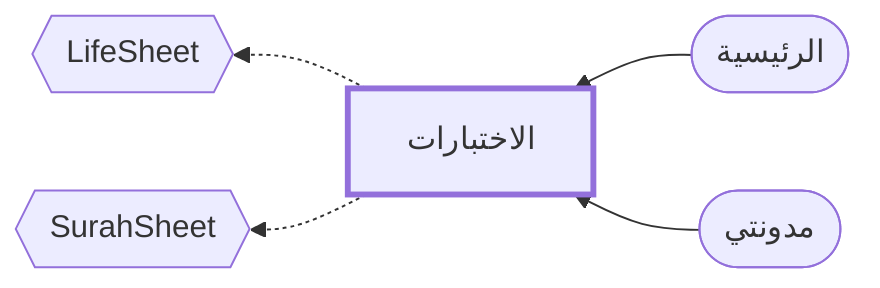

# الاختبارات

`mobile/src/app/(tabs)/quizzes.tsx` · [the whole map](../feature-map.md)

## Ways in

- The tab bar's «الاختبارات».
- [الرئيسية](home.md)
- [مدونتي](library.md)

## What it opens

| Part of the screen | Label | Opens | Code |
| --- | --- | --- | --- |
| `ForgottenPost` | افتح صفحة الآية | [صفحة الآية](ayah.md) | [components/HomeFeed.tsx:334](../../mobile/src/components/HomeFeed.tsx#L334) |
|  | افتح ما نسيته | [مدونتي](library.md) | [components/HomeFeed.tsx:335](../../mobile/src/components/HomeFeed.tsx#L335) |
|  | افتح الاختبارات | [الاختبارات](quizzes.md) | [components/HomeFeed.tsx:335](../../mobile/src/components/HomeFeed.tsx#L335) |
| `ReciteAction` | تسميع | [المصحف](read.md) | [components/HomeFeed.tsx:372](../../mobile/src/components/HomeFeed.tsx#L372) |
| `QuizPost` | افتح الاختبارات | [الاختبارات](quizzes.md) | [components/HomeFeed.tsx:454](../../mobile/src/components/HomeFeed.tsx#L454) |
|  | افتح ما يشرح الجواب | [الترجمة](person.md) | [components/HomeFeed.tsx:455](../../mobile/src/components/HomeFeed.tsx#L455) |
|  | افتح ما يشرح الجواب | [متشابهات القرآن](branches.md) | [components/HomeFeed.tsx:455](../../mobile/src/components/HomeFeed.tsx#L455) |
|  | افتح ما يشرح الجواب | [مقارنة السور](compare.md) | [components/HomeFeed.tsx:455](../../mobile/src/components/HomeFeed.tsx#L455) |
|  | افتح ما يشرح الجواب | [الأطلس](atlas.md) | [components/HomeFeed.tsx:455](../../mobile/src/components/HomeFeed.tsx#L455) |
|  | افتح ما يشرح الجواب | [قصة النبي](prophets-slug.md) | [components/HomeFeed.tsx:455](../../mobile/src/components/HomeFeed.tsx#L455) |
|  | افتح ما يشرح الجواب | [النسب](nasab.md) | [components/HomeFeed.tsx:455](../../mobile/src/components/HomeFeed.tsx#L455) |
|  | افتح ما يشرح الجواب | [المصطلح](term.md) | [components/HomeFeed.tsx:455](../../mobile/src/components/HomeFeed.tsx#L455) |
|  | افتح ما يشرح الجواب | [حديث الأربعين](hadith-forty.md) | [components/HomeFeed.tsx:455](../../mobile/src/components/HomeFeed.tsx#L455) |
|  | افتح ما يشرح الجواب | [كتاب الحديث](hadith-book.md) | [components/HomeFeed.tsx:455](../../mobile/src/components/HomeFeed.tsx#L455) |
|  | افتح ما يشرح الجواب | [أبواب الكتاب](hadith-kitab.md) | [components/HomeFeed.tsx:455](../../mobile/src/components/HomeFeed.tsx#L455) |
|  | افتح ما يشرح الجواب | [الحديث](hadith.md) | [components/HomeFeed.tsx:455](../../mobile/src/components/HomeFeed.tsx#L455) |
|  | افتح ما يشرح الجواب | [القصة](story.md) | [components/HomeFeed.tsx:455](../../mobile/src/components/HomeFeed.tsx#L455) |
|  | افتح ما يشرح الجواب | [الغزوة](battle.md) | [components/HomeFeed.tsx:455](../../mobile/src/components/HomeFeed.tsx#L455) |
|  | افتح ما يشرح الجواب | [المصحف](read.md) | [components/HomeFeed.tsx:455](../../mobile/src/components/HomeFeed.tsx#L455) |
|  | افتح ما يشرح الجواب | [تحفة الأطفال](tuhfa.md) | [components/HomeFeed.tsx:455](../../mobile/src/components/HomeFeed.tsx#L455) |
|  | افتح ما يشرح الجواب | [الذكر](dhikr.md) | [components/HomeFeed.tsx:455](../../mobile/src/components/HomeFeed.tsx#L455) |
|  | افتح ما يشرح الجواب | [ترتيب السور](order.md) | [components/HomeFeed.tsx:455](../../mobile/src/components/HomeFeed.tsx#L455) |
| `Item` | (onPress) | [الغزوة](battle.md) | [components/LifeTimeline.tsx:107](../../mobile/src/components/LifeTimeline.tsx#L107) |
|  | (onPress) | [القصة](story.md) | [components/LifeTimeline.tsx:107](../../mobile/src/components/LifeTimeline.tsx#L107) |
| `LifeSheet` | (onPress) | [الغزوة](battle.md) | [components/LifeTimeline.tsx:146](../../mobile/src/components/LifeTimeline.tsx#L146) |
|  | (onPress) | [القصة](story.md) | [components/LifeTimeline.tsx:146](../../mobile/src/components/LifeTimeline.tsx#L146) |
| `SurahCard` | ‹›:1 | [المصحف](read.md) | [components/OrderSurah.tsx:95](../../mobile/src/components/OrderSurah.tsx#L95) |
| `CompareFeedback` | افتح في مقارنة السور | [مقارنة السور](compare.md) | [components/QuizCompare.tsx:120](../../mobile/src/components/QuizCompare.tsx#L120) |
| `TreeActions` | افتح في متشابهات القرآن | [متشابهات القرآن](branches.md) | [components/QuizTree.tsx:181](../../mobile/src/components/QuizTree.tsx#L181) |
| `TermChips` | أمثلته في مصطلحات البلاغة | [المصطلح](term.md) | [components/TermSheet.tsx:34](../../mobile/src/components/TermSheet.tsx#L34) |
| `People` | (onPress) | [الترجمة](person.md) | [components/battles/BattleParts.tsx:113](../../mobile/src/components/battles/BattleParts.tsx#L113) |
| `Box` | (onPress) | [الترجمة](person.md) | [screens/nasab.tsx:31](../../mobile/src/screens/nasab.tsx#L31) |
| `QuizzesScreen` | (five) | [الاختبار](quiz-play.md) | [screens/quizzes.tsx:76](../../mobile/src/screens/quizzes.tsx#L76) |
|  | اختبار مخصص | [اختبار مخصص](quiz-solo.md) | [screens/quizzes.tsx:92](../../mobile/src/screens/quizzes.tsx#L92) |
|  | اختبار جماعي | [اختبار جماعي](quiz-party.md) | [screens/quizzes.tsx:93](../../mobile/src/screens/quizzes.tsx#L93) |
| `HadithOpen` | افتح ‹› | [حديث الصحيح](hadith-sahih.md) | [screens/story.tsx:68](../../mobile/src/screens/story.tsx#L68) |

## Sheets

- `LifeSheet`
- `SurahSheet`
