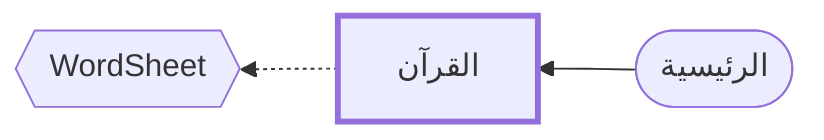

# القرآن

`mobile/src/app/(tabs)/(quran)/quran.tsx` · [the whole map](../feature-map.md)

## Ways in

- The tab bar's «القرآن».
- [الرئيسية](home.md)

## What it opens

| Part of the screen | Label | Opens | Code |
| --- | --- | --- | --- |
| `HitRow` | (onPress) | [المصحف](read.md) | [components/SearchResults.tsx:47](../../mobile/src/components/SearchResults.tsx#L47) |
|  | (onPress) | [المصحف](read.md) | [components/SearchResults.tsx:54](../../mobile/src/components/SearchResults.tsx#L54) |
|  | (onPress) | [متشابهات القرآن](branches.md) | [components/SearchResults.tsx:68](../../mobile/src/components/SearchResults.tsx#L68) |
|  | (onPress) | [مقارنة السور](compare.md) | [components/SearchResults.tsx:74](../../mobile/src/components/SearchResults.tsx#L74) |
|  | (onPress) | [قصة النبي](prophets-slug.md) | [components/SearchResults.tsx:81](../../mobile/src/components/SearchResults.tsx#L81) |
|  | (onPress) | [القصة](story.md) | [components/SearchResults.tsx:82](../../mobile/src/components/SearchResults.tsx#L82) |
|  | (onPress) | [قصص السيرة](stories.md) | [components/SearchResults.tsx:82](../../mobile/src/components/SearchResults.tsx#L82) |
|  | (onPress) | [الترجمة](person.md) | [components/SearchResults.tsx:89](../../mobile/src/components/SearchResults.tsx#L89) |
|  | (onPress) | [الغزوة](battle.md) | [components/SearchResults.tsx:89](../../mobile/src/components/SearchResults.tsx#L89) |
|  | (onPress) | [حديث الأربعين](hadith-forty.md) | [components/SearchResults.tsx:96](../../mobile/src/components/SearchResults.tsx#L96) |
|  | (onPress) | [حديث الصحيح](hadith-sahih.md) | [components/SearchResults.tsx:96](../../mobile/src/components/SearchResults.tsx#L96) |
|  | (onPress) | [أبواب الكتاب](hadith-kitab.md) | [components/SearchResults.tsx:96](../../mobile/src/components/SearchResults.tsx#L96) |
|  | (onPress) | [تحفة الأطفال](tuhfa.md) | [components/SearchResults.tsx:107](../../mobile/src/components/SearchResults.tsx#L107) |
|  | (onPress) | [الذكر](dhikr.md) | [components/SearchResults.tsx:117](../../mobile/src/components/SearchResults.tsx#L117) |
|  | (onPress) | [المصحف](read.md) | [components/SearchResults.tsx:123](../../mobile/src/components/SearchResults.tsx#L123) |
| `WordView` | (open) | [المصحف](read.md) | [components/WordSheet.tsx:111](../../mobile/src/components/WordSheet.tsx#L111) |
| `QURAN_TILES` | المصحف | [المصحف](read.md) | [screens/quran.tsx:19](../../mobile/src/screens/quran.tsx#L19) |
|  | متشابهات القرآن | [متشابهات القرآن](branches.md) | [screens/quran.tsx:20](../../mobile/src/screens/quran.tsx#L20) |
|  | مقارنة السور | [مقارنة السور](compare.md) | [screens/quran.tsx:21](../../mobile/src/screens/quran.tsx#L21) |
|  | قصص الأنبياء | [قصص الأنبياء](prophets.md) | [screens/quran.tsx:22](../../mobile/src/screens/quran.tsx#L22) |
|  | تحفة الأطفال | [تحفة الأطفال](tuhfa.md) | [screens/quran.tsx:23](../../mobile/src/screens/quran.tsx#L23) |
|  | ألفاظ القرآن | [ألفاظ القرآن](words.md) | [screens/quran.tsx:24](../../mobile/src/screens/quran.tsx#L24) |
|  | الأقسام | [الأقسام](oaths.md) | [screens/quran.tsx:25](../../mobile/src/screens/quran.tsx#L25) |
|  | مشاهد | [مشاهد](lataif.md) | [screens/quran.tsx:26](../../mobile/src/screens/quran.tsx#L26) |
|  | مصطلحات البلاغة | [مصطلحات البلاغة](terms.md) | [screens/quran.tsx:27](../../mobile/src/screens/quran.tsx#L27) |
|  | القراءات | [القراءات](qiraat.md) | [screens/quran.tsx:28](../../mobile/src/screens/quran.tsx#L28) |
|  | فواتح السور | [فواتح السور](openings.md) | [screens/quran.tsx:29](../../mobile/src/screens/quran.tsx#L29) |
|  | ترتيب السور | [ترتيب السور](order.md) | [screens/quran.tsx:30](../../mobile/src/screens/quran.tsx#L30) |

## Sheets

- `WordSheet`
