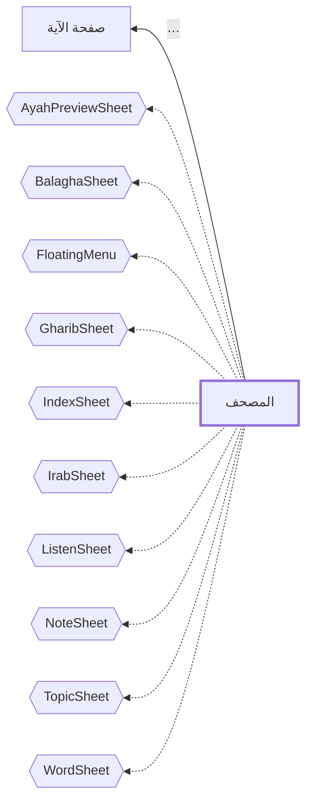

# المصحف

`mobile/src/app/(tabs)/read.tsx` · [the whole map](../feature-map.md)

## Ways in

- [المصطلح](term.md)
- [الرئيسية](home.md)
- [مقارنة السور](compare.md)
- [مدونتي](library.md)
- [قصص الأنبياء](prophets.md)
- [قصة النبي](prophets-slug.md)
- [الاختبارات](quizzes.md)
- [ترتيب السور](order.md)
- [غرفة الاختبار الجماعي](quiz-party-code.md)
- [الاختبار](quiz-play.md)
- [البحث](search.md)
- [القرآن](quran.md)
- [الأدوات والأذكار](utilities.md)
- [الكلمة](word.md)
- [صفحة الآية](ayah.md)
- [الكتاب](book.md)
- [الأقسام](oaths.md)
- [فواتح السور](openings.md)

## What it opens

| Part of the screen | Label | Opens | Code |
| --- | --- | --- | --- |
| `Reader` | (page) | [صفحة الآية](ayah.md) | [components/Reader.tsx:437](../../mobile/src/components/Reader.tsx#L437) |
| `WordView` | (open) | [المصحف](read.md) | [components/WordSheet.tsx:111](../../mobile/src/components/WordSheet.tsx#L111) |

## Sheets

- `AyahPreviewSheet`
- `BalaghaSheet`
- `FloatingMenu`
- `GharibSheet`
- `IndexSheet`
- `IrabSheet`
- `ListenSheet`
- `NoteSheet`
- `TopicSheet`
- `WordSheet`
