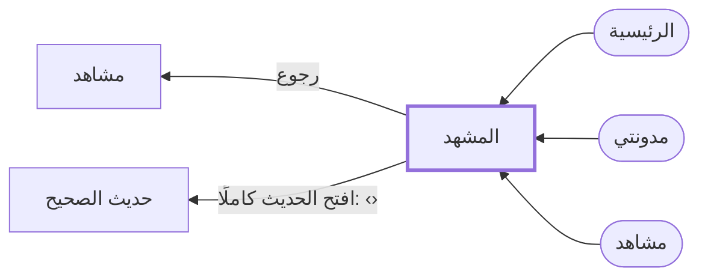

# المشهد

`mobile/src/app/scene.tsx` · [the whole map](../feature-map.md)

## Ways in

- [الرئيسية](home.md)
- [مدونتي](library.md)
- [مشاهد](lataif.md)

## What it opens

| Part of the screen | Label | Opens | Code |
| --- | --- | --- | --- |
| `DarkSea` | رجوع | [مشاهد](lataif.md) | [components/DarkSea.tsx:160](../../mobile/src/components/DarkSea.tsx#L160) |
| `RahmanScene` | رجوع | [مشاهد](lataif.md) | [components/RahmanScene.tsx:140](../../mobile/src/components/RahmanScene.tsx#L140) |
| `Hadith` | افتح الحديث كاملًا: ‹› | [حديث الصحيح](hadith-sahih.md) | [components/scenes/RahmanPage.tsx:143](../../mobile/src/components/scenes/RahmanPage.tsx#L143) |

## Sheets

None of its own.
