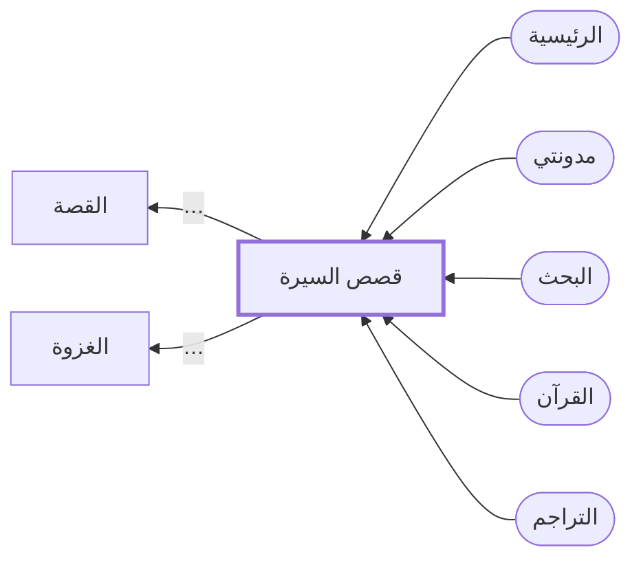

# قصص السيرة

`mobile/src/app/(tabs)/(tarajim)/stories.tsx` · [the whole map](../feature-map.md)

## Ways in

- [الرئيسية](home.md)
- [مدونتي](library.md)
- [البحث](search.md)
- [القرآن](quran.md)
- [التراجم](tarajim.md)

## What it opens

| Part of the screen | Label | Opens | Code |
| --- | --- | --- | --- |
| `StoryRow` | (onPress) | [القصة](story.md) | [screens/stories.tsx:37](../../mobile/src/screens/stories.tsx#L37) |
| `ChapterCard` | (onPress) | [الغزوة](battle.md) | [screens/stories.tsx:58](../../mobile/src/screens/stories.tsx#L58) |

## Sheets

None of its own.
