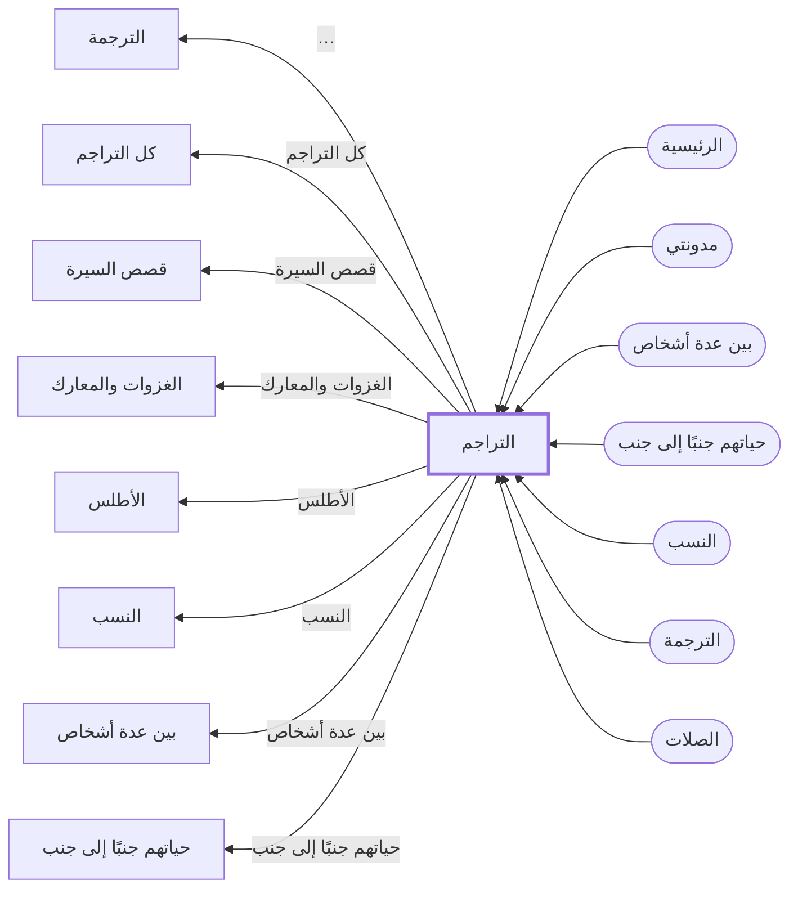

# التراجم

`mobile/src/app/(tabs)/(tarajim)/tarajim.tsx` · [the whole map](../feature-map.md)

## Ways in

- The tab bar's «التراجم».
- [الرئيسية](home.md)
- [مدونتي](library.md)
- [بين عدة أشخاص](between.md)
- [حياتهم جنبًا إلى جنب](life.md)
- [النسب](nasab.md)
- [الترجمة](person.md)
- [الصلات](ties.md)

## What it opens

| Part of the screen | Label | Opens | Code |
| --- | --- | --- | --- |
| `PersonRows` | (onPress) | [الترجمة](person.md) | [components/tarajim/PersonRows.tsx:21](../../mobile/src/components/tarajim/PersonRows.tsx#L21) |
| `TarajimScreen` | كل التراجم | [كل التراجم](people.md) | [screens/tarajim.tsx:49](../../mobile/src/screens/tarajim.tsx#L49) |
|  | قصص السيرة | [قصص السيرة](stories.md) | [screens/tarajim.tsx:52](../../mobile/src/screens/tarajim.tsx#L52) |
|  | الغزوات والمعارك | [الغزوات والمعارك](battles.md) | [screens/tarajim.tsx:53](../../mobile/src/screens/tarajim.tsx#L53) |
|  | الأطلس | [الأطلس](atlas.md) | [screens/tarajim.tsx:54](../../mobile/src/screens/tarajim.tsx#L54) |
|  | النسب | [النسب](nasab.md) | [screens/tarajim.tsx:58](../../mobile/src/screens/tarajim.tsx#L58) |
|  | بين عدة أشخاص | [بين عدة أشخاص](between.md) | [screens/tarajim.tsx:59](../../mobile/src/screens/tarajim.tsx#L59) |
|  | حياتهم جنبًا إلى جنب | [حياتهم جنبًا إلى جنب](life.md) | [screens/tarajim.tsx:60](../../mobile/src/screens/tarajim.tsx#L60) |

## Sheets

None of its own.
