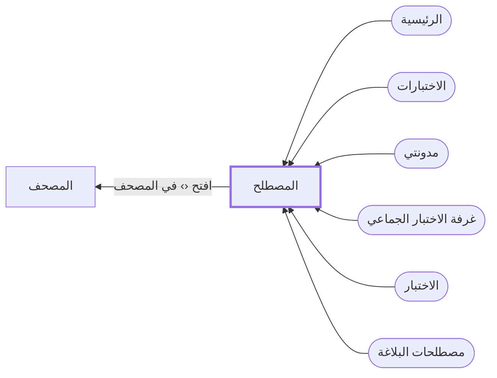

# المصطلح

`mobile/src/app/(tabs)/(quran)/term.tsx` · [the whole map](../feature-map.md)

## Ways in

- [الرئيسية](home.md)
- [الاختبارات](quizzes.md)
- [مدونتي](library.md)
- [غرفة الاختبار الجماعي](quiz-party-code.md)
- [الاختبار](quiz-play.md)
- [مصطلحات البلاغة](terms.md)

## What it opens

| Part of the screen | Label | Opens | Code |
| --- | --- | --- | --- |
| `TermExampleCard` | افتح ‹› في المصحف | [المصحف](read.md) | [components/BalaghaTerm.tsx:73](../../mobile/src/components/BalaghaTerm.tsx#L73) |

## Sheets

None of its own.
