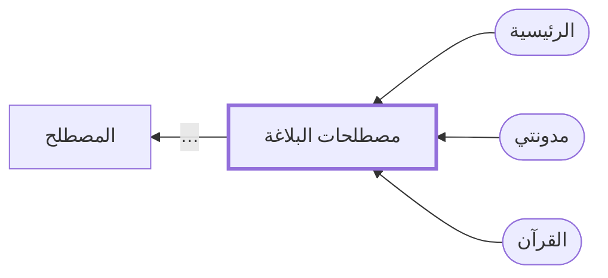

# مصطلحات البلاغة

`mobile/src/app/(tabs)/(quran)/terms.tsx` · [the whole map](../feature-map.md)

## Ways in

- [الرئيسية](home.md)
- [مدونتي](library.md)
- [القرآن](quran.md)

## What it opens

| Part of the screen | Label | Opens | Code |
| --- | --- | --- | --- |
| `BalaghaTermsScreen` | (onPress) | [المصطلح](term.md) | [screens/balaghaTerms.tsx:42](../../mobile/src/screens/balaghaTerms.tsx#L42) |

## Sheets

None of its own.
