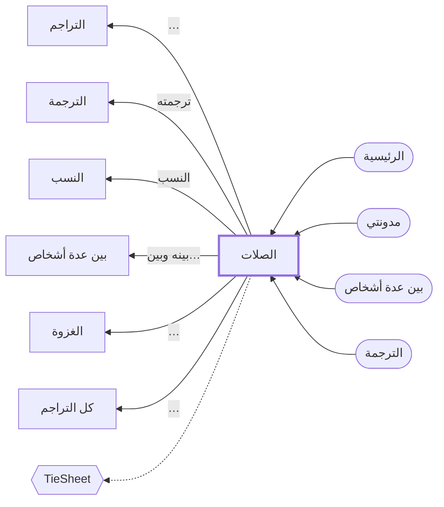

# الصلات

`mobile/src/app/(tabs)/(tarajim)/ties.tsx` · [the whole map](../feature-map.md)

## Ways in

- [الرئيسية](home.md)
- [مدونتي](library.md)
- [بين عدة أشخاص](between.md)
- [الترجمة](person.md)

## What it opens

| Part of the screen | Label | Opens | Code |
| --- | --- | --- | --- |
| `TiesScreen` | (back) | [التراجم](tarajim.md) | [screens/ties.tsx:31](../../mobile/src/screens/ties.tsx#L31) |
|  | ترجمته | [الترجمة](person.md) | [screens/ties.tsx:50](../../mobile/src/screens/ties.tsx#L50) |
|  | النسب | [النسب](nasab.md) | [screens/ties.tsx:51](../../mobile/src/screens/ties.tsx#L51) |
|  | بينه وبين… | [بين عدة أشخاص](between.md) | [screens/ties.tsx:52](../../mobile/src/screens/ties.tsx#L52) |
|  | (onPress) | [الغزوة](battle.md) | [screens/ties.tsx:60](../../mobile/src/screens/ties.tsx#L60) |
|  | (onPress) | [كل التراجم](people.md) | [screens/ties.tsx:69](../../mobile/src/screens/ties.tsx#L69) |

## Sheets

- `TieSheet`
