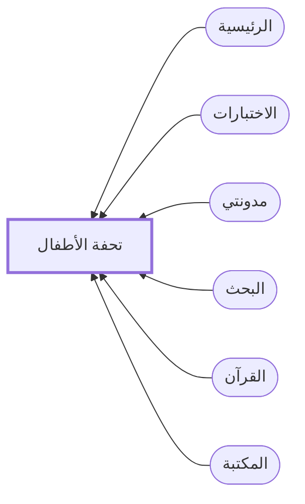

# تحفة الأطفال

`mobile/src/app/(tabs)/(quran)/tuhfa.tsx` · [the whole map](../feature-map.md)

## Ways in

- [الرئيسية](home.md)
- [الاختبارات](quizzes.md)
- [مدونتي](library.md)
- [البحث](search.md)
- [القرآن](quran.md)
- [المكتبة](books.md)

## What it opens

Nothing of its own: only the bars every screen has.

## Sheets

None of its own.
