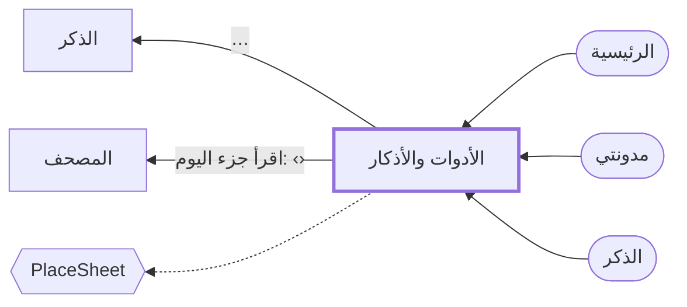

# الأدوات والأذكار

`mobile/src/app/(tabs)/(home)/utilities.tsx` · [the whole map](../feature-map.md)

## Ways in

- [الرئيسية](home.md)
- [مدونتي](library.md)
- [الذكر](dhikr.md)

## What it opens

| Part of the screen | Label | Opens | Code |
| --- | --- | --- | --- |
| `DhikrRow` | ‹›‹› | [الذكر](dhikr.md) | [components/Adhkar.tsx:110](../../mobile/src/components/Adhkar.tsx#L110) |
| `Month` | اقرأ جزء اليوم: ‹› | [المصحف](read.md) | [components/Utilities.tsx:381](../../mobile/src/components/Utilities.tsx#L381) |
| `Calendar` | اقرأ جزء اليوم: ‹› | [المصحف](read.md) | [components/Utilities.tsx:411](../../mobile/src/components/Utilities.tsx#L411) |

## Sheets

- `PlaceSheet`
