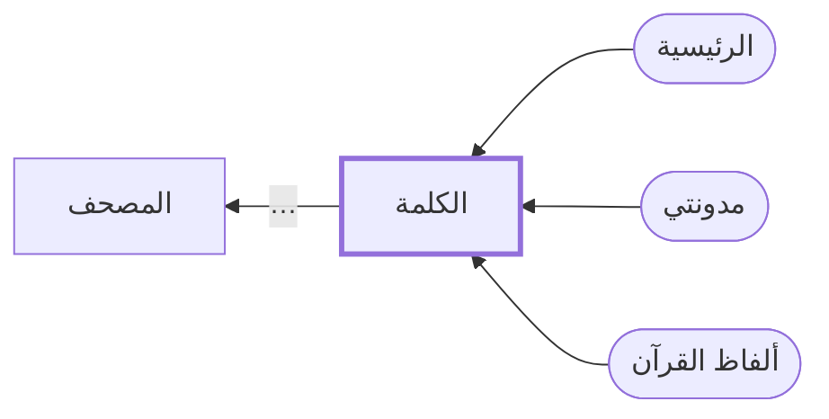

# الكلمة

`mobile/src/app/(tabs)/(quran)/word.tsx` · [the whole map](../feature-map.md)

## Ways in

- [الرئيسية](home.md)
- [مدونتي](library.md)
- [ألفاظ القرآن](words.md)

## What it opens

| Part of the screen | Label | Opens | Code |
| --- | --- | --- | --- |
| `WordView` | (open) | [المصحف](read.md) | [components/WordSheet.tsx:140](../../mobile/src/components/WordSheet.tsx#L140) |

## Sheets

None of its own.
