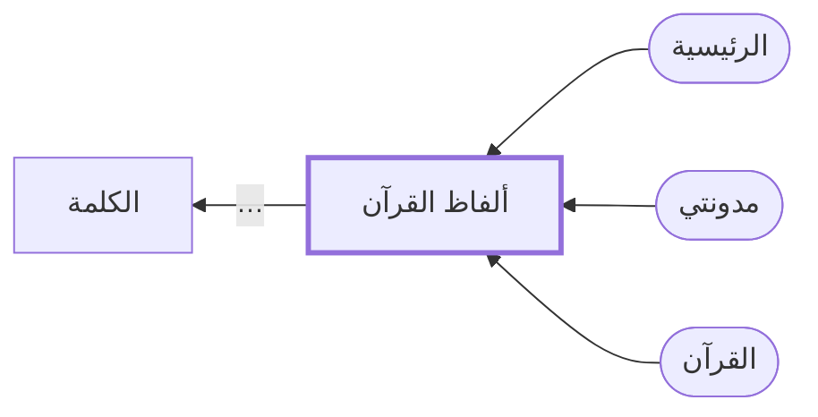

# ألفاظ القرآن

`mobile/src/app/(tabs)/(quran)/words.tsx` · [the whole map](../feature-map.md)

## Ways in

- [الرئيسية](home.md)
- [مدونتي](library.md)
- [القرآن](quran.md)

## What it opens

| Part of the screen | Label | Opens | Code |
| --- | --- | --- | --- |
| `WordsScreen` | ‹›، ‹› مرة | [الكلمة](word.md) | [screens/words.tsx:49](../../mobile/src/screens/words.tsx#L49) |

## Sheets

None of its own.
